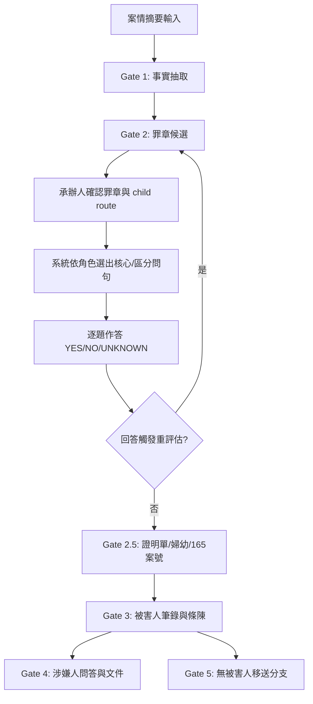

# 法律案件工作台

本專案是**獨立、本機優先**的 Gate 1–5 法律案件工作台。它不會復原父目錄中已刪除的舊系統檔案。Gate 1 固定在本機處理，Gate 2 外部 AI 預設關閉，只有明確啟用並由操作人員逐次同意才會送出摘要。

---

## 快速導覽

| 區塊 | 說明 |
|------|------|
| [啟動方式](#啟動方式) | 環境需求與一鍵啟動指令 |
| [核心流程](#核心流程-gate-15) | 12 步驟完整業務流程 |
| [法律與人工核准邊界](#法律與人工核准邊界) | 系統不做法律判斷的具體界線 |
| [外部 AI 邊界](#外部-ai-邊界) | API 金鑰、同意機制、資料外送範圍 |
| [問句來源與優先序](#問句來源與優先序) | 6 層題庫載入順序與去重機制 |
| [文件規則](#文件規則) | DOCX 輸出規格、頁數檢查、字數限制 |
| [隱私與安全](#隱私與安全) | 本機綁定、記憶體隔離、稽核不落地 |
| [專案架構與維護界線](#專案架構與維護界線) | 正式路徑、儲存實作、原型隔離、PoC 狀態 |
| [語意推理模組](#語意推理模組) | 14 個核心模組職責對照表 |
| [驗證與測試](#驗證與測試) | 執行指令、覆蓋範圍、最近驗證紀錄 |

---

## 啟動方式

**需求**：Windows、Python 3、LibreOffice，以及 `requirements.txt` 中的套件。

```powershell
cd D:\工作用\judicial1\legal-case-web
py -3 -m pip install -r requirements.txt
.\start.ps1
```

- 網址固定為 `http://127.0.0.1:8787/`
- 服務**不監聽外部網路介面**（僅綁定 `127.0.0.1`）
- `start.ps1` 會檢查原始碼異動並自動重啟服務，確保瀏覽器載入最新版本

---

## 核心流程



### 12 步驟詳細說明

1. **輸入案情摘要** —— 首頁僅接受自由敘述；請在摘要內以「發生／查獲時間：」「發生／查獲地點：」「案情經過：」標明資料（進階欄位收合）。未明示標籤時，時間或地點保留為 `UNKNOWN`，**不自行猜測**。
2. **Gate 1 事實抽取** —— 從自由敘述抽取中性事實。沒有證據支持的原持有、同意、保管、取得手段、返還約定及主觀意圖維持 `UNKNOWN`。
3. **Gate 2 罪章候選** —— 以確定性規則或經明示同意的外部 AI（api.iamhc.cn，OpenAI 相容）提出零個或多個候選罪章；候選只代表待區分方向，**不代表犯罪成立**。關聯候選只供人工區辨，不會自動進入問句。
4. **人工確認** —— 承辦人分別確認候選罪章與 child legal route。兩者原子保存；目前 child route 僅作為法律脈絡，問句覆蓋狀態維持 `PARENT_PACK_ONLY / NONE`。
5. **問句選擇** —— 系統依角色及候選方向選出核心問句與區分問句。每題同時連結 `fact_target` 及 `legal_targets`。
6. **作答與重評估** —— 回答的自由文字只保存為陳述。只有操作人員明確選擇的 `YES`、`NO` 或 `UNKNOWN` 事實狀態會觸發候選重評估；衝突資訊維持 `NEED_REVIEW`。
7. **Gate 2 基本資料** —— 同頁填寫受詢問人年籍與詢問起訖時間，問答採逐題呈現（上一題／下一題／進度）。
8. **Gate 2.5 條件欄位** —— 依規則顯示證明單、婦幼及 165 案號欄位。
9. **Gate 3 輸出** —— 產生被害人筆錄及條陳。
10. **Gate 4 延伸** —— 同一案件可繼續涉嫌人問答及文件。
11. **Gate 5 移送** —— 無被害人案件使用移送分支。
12. **單案件隔離** —— 目前案件可在同一瀏覽器流程內退回修正；建立下一件案件時，前一件即自記憶體工作區移除。

---

## 法律與人工核准邊界

- **候選引擎非法律判斷**：確定性規則或外部 AI 分類，兩者都不是法律判斷。
- **可安全回傳零候選**：系統不強制產生候選。
- **候選狀態機**：初始 `NEED_REVIEW` → 經 answer mapping 可變為 `ACTIVE` 或 `LOWERED`；三種狀態**均不代表犯罪成立或排除**。
- **題庫人工審核**：維持 `HUMAN_REVIEW_REQUIRED`，啟動時載入父目錄 `questions/` 中已核實的全罪章 Markdown 問句（核心／補充／補強／區分／加重分節載入）。
- **公司範本逐字保留**：三份範本（通用被害人、通用涉嫌人、移送涉嫌人）之必問題逐字保留於 `app/company_templates.py`；筆錄輸出含公司表頭、年籍表、應告知事項（刑訴 §95 經 §100-2 準用；移送另含提審法 §1）及簽名區。
- **公司套表罪章題**：`新套表.xlsm` 各罪章欄逐字載入（`app/xlsm_questions.py`），公式插值題跳過由承辦人補實。
- **操作人員全程確認**：必須確認 Gate 1、罪章、問句與回答後才能輸出。
- **文件完整性門檻**：法源、程序或必要案號不足時，**不得**把文件標示為完整。
- **法規核對入口**（2026-10-11 以 twlegalrag 核對現行條文）：
  - 刑事訴訟法 §95、§100-2、§100-3：https://law.moj.gov.tw/LawClass/LawAll.aspx?PCode=C0010001
  - 提審法 §1：https://law.moj.gov.tw/LawClass/LawAll.aspx?PCode=C0010008
  - 個人資料保護法：https://law.moj.gov.tw/LawClass/LawAll.aspx?PCode=I0050021
- **《警察犯罪偵查手冊》**：現行公開全文仍為 `UNKNOWN`，因此題庫**不可宣稱**已依該手冊逐條核准。

---

## 外部 AI 邊界

| 條件 | 說明 |
|------|------|
| **雙重啟用** | 必須同時設定 `ALLOW_EXTERNAL_AI=true` 與 `IAMHC_API_KEY` |
| **逐次同意** | Gate 2 勾選明示同意後，才可送出案情摘要 |
| **Gate 1 永不外送** | 永遠使用本機規則切分，不因 API key 存在而外送 |
| **傳輸範圍** | 僅 Gate 2 候選罪章分析可送出案情摘要（上限 4000 字）至 `IAMHC_BASE_URL`（預設 `https://api.iamhc.cn/v1`） |
| **金鑰管理** | 存於 `legal-case-web/.env`（`IAMHC_API_KEY`），已列入 `.gitignore` |
| **失敗退回** | 金鑰未設定或服務失敗時自動退回規則候選；重試 4 次後放棄 |
| **資料不外送** | 年籍、問答內容、案號、條陳**不送任何外部服務** |

---

## 問句來源與優先序

一般路由載入順序（詳見 `docs/QUESTION_DESIGN_AND_USE.md` 第六節）：

1. **公司三份 `.doc` 範本通用必問題**（`app/company_templates.py`，逐字）
2. **通用程序題**（`data/question_bank.json` common）
3. **公司套表罪章題**（`data/xlsm_questions.json`，抽取自 `新套表.xlsm` 被害人／涉嫌人／證人筆錄工作表之各罪章欄，公式插值題跳過）
4. **本庫 Markdown 核心／補充／補強／區分／加重題**（`questions/*.md`，分節載入）
5. **JSON 要件題**（僅在 md 未涵蓋同一 element 時補入）
6. **受控情境問句**（`app/questions.py`，例如財物取走的 7 題中性事實題）

### 關鍵機制

- **語意去重**：語意相同之題目自動去重（全文比對）
- **容量校準**：八頁校準總容量為 97 題；被害人固定 company/common 共 19 題，因此 offense 題上限為 78
- **優先保留**：公司題與核心題優先保留，實際輸出仍以 LibreOffice 頁數檢查 **fail closed**
- **財物取走情境**：已辨識的情境不會整批展開 Markdown／JSON 延伸題；執行時保留公司固定題、通用程序題及 XLSM 公司罪章題，再加入 7 題角色化核心／區分問句；完整題庫仍保留作為覆蓋與人工審查來源

---

## 文件規則

- **格式**：輸出 `.docx`，不修改三份舊式 `.doc`
- **結構重建**：筆錄 DOCX 依公司範本結構重建：標題列、詢問時間地點、案由、受詢問人年籍表（11 欄＋家庭經濟狀況）、涉嫌人應告知事項、問答、結尾簽名區
- **版面固定**：A4、標楷體 12pt、1.15 倍行距
- **頁數檢查**：下載筆錄前，以本機 LibreOffice 轉成 PDF 並讀取實際頁數；**超過 8 頁、LibreOffice 不存在或排版失敗時，系統會阻止筆錄下載**
- **條陳長度**：案情摘要最多 500 個 Unicode 字元；超過時阻止寫入，**不得靜默截斷**
- **無加密**：下載的 DOCX 是未加密明文，使用者需自行依機關規定保存

---

## 隱私與安全

- **本機綁定**：預設僅綁定 IPv4 `127.0.0.1`；人工覆寫 `HOST` 會改變網路暴露面，**不屬於本機模式的安全保證**
- **CORS 關閉**：例外：Gate 2 罪章候選可送案情摘要至外部 AI
- **API 驗證**：記憶體 session token、`Host`、`Origin` 及 body 大小（256 KB）
- **回應強化**：CSP、`no-store`、`nosniff` 與 frame deny
- **單案件記憶體工作區**：不顯示「已保存案件」，也不把案件內容寫入 SQLite
- **自動清除**：每次建立新案件都會清除上一件的記憶體工作區；服務重啟後案件亦不保留
- **稽核不落地**：稽核事件不保存姓名、案號、自由文字或問答內容
- **相容模組隔離**：`CaseStore`／DPAPI 僅保留為未接入 runtime 的相容性模組與安全測試，**不代表目前有案件歷史功能**

---

## 專案架構與維護界線

- **正式啟動路徑**：`start.ps1` → `app.server`；HTTP API 將 Gate 與案件狀態交由 `app.workflow`，再串接規則、問句及文件模組
- **Runtime 儲存**：使用 `EphemeralCaseStore`，只保留單一案件於程序記憶體。`CaseStore`／DPAPI 與 SQLite 相容程式碼**不代表已啟用持久化案件功能**
- **原型隔離**：`web_app/` 是獨立 Next.js 原型，不是上述正式啟動路徑；修改前應確認目標是本機工作台或原型
- **PoC 隔離**：法律檢索與罪章關聯 PoC 維持離線／審查用途；未完成指定 Human Gate 前，**不得接入 runtime 或宣稱已獲法律核准**
- **證據分級**：法源可回查、測試通過與文件成功產生，均屬**工程或來源證據**，不等於法律內容完整或人工核准完成

### 目錄結構重點

```
legal-case-web/
├── app/                    # 核心後端邏輯
│   ├── server.py           # HTTP 進入點、安全守衛
│   ├── workflow.py         # Gate 狀態機、案件快照
│   ├── rules.py            # Gate 1 分析、規則候選、題目整合
│   ├── questions.py        # 問句 metadata、預算、重評估
│   ├── documents.py        # DOCX 產生與頁數驗證
│   ├── storage.py          # EphemeralCaseStore / CaseStore
│   ├── acts.py             # 行為模型與競合分析
│   ├── legal_retrieval*.py # 法律檢索 PoC（離線、未接入 runtime）
│   └── *.py                # 其他支援模組
├── data/                   # Runtime 資料檔
│   ├── question_bank.json
│   ├── xlsm_questions.json
│   ├── legal_route_crosswalk.json
│   └── offense_linkage_poc.json
├── questions/              # Markdown 題庫（核心／補充／區分／加重）
├── docs/                   # 架構、設計、審查工作表、證據封包
├── tests/                  # pytest + Node 測試
├── tools/                  # 輔助工具
└── web_app/                # Next.js 原型（獨立啟動）
```

---

## 語意推理模組

| 模組 | 職責 | 非職責 |
|------|------|--------|
| `app/acts.py` | 行為模型與競合分析（不自動定性；竊盜/侵占區辨含經核實裁判錨點） | 自動認定一行為／數行為或競合結論 |
| `app/questions.py` | 問句 metadata、動態預算、條件觸發、回答驅動重評估、品質檢核 | 從自由文字直接定罪 |
| `app/document_validation.py` | 筆錄/條陳完整性驗證（下載前 fail closed） | 決定罪章成立 |
| `app/law_reference.py` | 法源快照與行為時法警示 | 取代人工法律核對 |
| `app/legal_semantic_corpus.py` | 固定語意測試集（32 案例）+ 差異測試（6 案例） | — |
| `app/offense_linkage.py` | 驗證離線罪章關聯 PoC（普通竊盜、加重竊盜、普通侵占） | 接入 Gate 2、計算有罪機率或自動認定罪章 |
| `app/legal_retrieval.py` | 結構性去識別查詢、防竄改驗證、離線 adapter 契約 | 接收案件全文、呼叫外部 MCP／PSUE、變更候選狀態 |
| `app/legal_retrieval_cache.py` | 正規化來源 metadata、區分 hash scope、兩層完整性驗證、明示路徑原子寫入 | 保存全文／節錄／案件個資、建立預設正式快取 |
| `app/legal_provider_fixtures.py` | 離線解析已有證據的 provider fixture、無公開契約來源鎖為 discovery-only | 發出網路請求、猜測 schema、清除正式快取、接入 Gate 2 |
| `app/legal_retrieval_reconciliation.py` | Registry 精確映射來源 locator、明示 cache 路徑原子移除 metadata、去識別 tombstone | 模糊匹配、保存原始 locator、恢復官方已移除來源、接入 runtime |
| `app/legal_retrieval_sync.py` | 離線協調器（預設 dry-run）、adapter、正規化、cache 寫入與移除 | 使用外部網路 adapter、接受 provider 身分不一致、建立預設 cache、接入 Gate 2 |
| `app/legal_retrieval_batch.py` | Deterministic manifest 驗證、記憶體依序套用多 provider、單次原子提交 | 部分提交、忽略 cache 漂移、保存案件內容、排程執行、接入 runtime |
| `app/legal_retrieval_replay.py` | 合成 golden corpus 重播、allowlist provider、固定結果投影與證據 hash | 接受案件資料、輸出 fixture／錯誤內文、覆寫既有 scratch cache、宣稱法律驗收 |

> **關鍵資料檔**：
> - `data/offense_linkage_poc.json`：法條、裁判錨點、child route、區分軸與中性問句可追溯關聯；固定 `runtime_enabled: false / HUMAN_REVIEW_REQUIRED`；公開起訴書 `NOT_INGESTED`，**不得用此 PoC 宣稱已完成起訴書檢索或法律判斷**
> - `docs/evidence/legal_retrieval_human_gate_packet.json`：凍結 10 個 PoC 核心檔案與 4 個 runtime surface hash，記錄 golden replay、測試結果、`UNKNOWN` 與五項必要人工核准；狀態 `PENDING_HUMAN_APPROVAL`，**hash 漂移即失效**
> - `docs/evidence/hg_lr_01_provider_contract_review.json`：司法院 JDoc、PSUE、Taiwan Law MCP、TLR hosted、mcp-taiwan-legal-db 分類盤點；`PARTIAL_REVIEW_HUMAN_APPROVAL_REQUIRED`，**不選定 provider、不授權 live call**
> - `docs/evidence/hg_lr_02_privacy_security_review.json`：query、provider boundary、metadata cache、removal audit、報告資料流；`CHANGES_REQUIRED_HUMAN_APPROVAL_PENDING`，**不得啟用外部查詢或正式 cache**

---

## 法源核實現況

- 44 個啟用路由均有法源紀錄、明示 crosswalk 狀態及至少一個 child route
- 共拆出 310 個仍待人工審查的 legal routes
- `VERIFIED_CURRENT` 僅表示所列主要法源在指定資料版本中可回查，**不表示**所有罪名、特別法競合、行為時法或問句均已完成人工審查
- 6 個路由標記 `PARTIAL_SCOPE`；其中 `public_danger` 明確只涵蓋酒毒駕與交通事故逃逸，**不涵蓋**公共危險章其他犯罪
- 候選輸出依路由型態維持 fail closed；行為時間早於法條修正日時仍會記錄 `temporal_law_warnings`

---

## 問句生成管線

```
公司必問 → 通用題 → 公司罪章題 → md 題 → JSON 要件題 → metadata 豐富化 → 品質檢核（Q1-Q10）
```

- `core` 與 `company_offense` **不得**為符合頁數而靜默裁切
- 必要題超過預算時直接 **fail closed**，要求承辦人縮小本次路由範圍

---

## 品質審查三層關

1. **生成時程式化檢核**（Q1-Q10）
2. **pytest 品質測試集**（含誘導/定性語句掃描）
3. **承辦人人工審核**（題庫變更時）

---

## 驗證與測試

### 執行指令

```powershell
# Python 完整測試
py -3 -X utf8 -m pytest -q

# 前端靜態檢查
node --check app\static\app.js
```

### 最近驗證（2026-10-19）

- **364 passed**（完整 pytest）
- `node -- check`、Python `compileall`、`git diff --check` 全數通過
- Next.js production build 與 ESLint 通過
- Prototype `npm audit --audit-level=moderate`：**0 vulnerabilities**
- Edge 實際走過三種分支：
  - 被害人分支：35 題
  - 同案涉嫌人續辦：33 題
  - 無被害人移送：28 題
- Next.js 原型以 mocked AI 驗證 Gate 1/2、TXT 與 DOCX 產出
- 響應式斷點：桌面、768px、375px 均無水平溢位
- **外部 AI 未實際呼叫**；以上為程式與本機操作證據，**不代表**法律內容完整、視覺回歸基準存在或 Human Gate 通過

### 測試覆蓋重點

零候選、AI 候選解析與失敗退回、關聯候選、問句單一判斷、公司必問逐字輸出、xlsm 公司罪章題載入、權利告知與提審告知、案號條件、500 字摘要、Gate 禁止跳過、年籍儲存、向後修改失效、同案被害人至涉嫌人流程、無被害人分支、單案件記憶體隔離、revision 衝突、DOCX 完整性、LibreOffice 實際頁數、session token、Host、Origin、CSP、CORS 及路徑穿越、前端 409 安全回載；未接線的 DPAPI／SQLite 相容模組另有獨立安全測試。

### 前端錯誤恢復行為

- **API 非 2xx**：安全解析 JSON `message`/`error`；非 JSON 或 HTML 一律使用安全預設訊息，**不顯示 raw body**
- **`fetch` 失敗（斷線）**：顯示繁中「無法連線到本機服務，請確認服務仍在執行。」，**不洩漏**瀏覽器英文錯誤或 stack
- **409 `REVISION_CONFLICT`**：原 POST 精確 1 次、**不自動重送 mutation**；僅在仍指向同一案件時載入並渲染最新案件，提示「已載入最新版本，請核對後重試」；回載失敗則保留原版本並提示重新選取或重試
- **永久行為測試**：`tests/test_frontend_api_errors.mjs`（22 案例，Node vm 載入實際 app.js）＋ `tests/test_frontend_api_errors.py`（pytest wrapper，UTF-8 fail closed）

---

## 開發者指南

### 核心邏輯切入點

| 想改的功能 | 從這裡開始 |
|------------|------------|
| 新增/修改罪章路由 | `data/question_bank.json`、`data/legal_route_crosswalk.json` |
| 調整問句選擇邏輯 | `app/rules.py`、`app/questions.py` |
| 修改 Gate 狀態流轉 | `app/workflow.py` |
| 文件輸出格式 | `app/documents.py`、`app/document_validation.py` |
| 新增題庫來源 | `app/markdown_questions.py`、`app/xlsm_questions.py` |
| 法律檢索 PoC | `app/legal_retrieval*.py`、`data/offense_linkage_poc.json` |

### 常用操作

```powershell
# 單一測試檔
py -3 -X utf8 -m pytest tests/test_rules.py -q

# 只跑關鍵字
py -3 -X utf8 -m pytest -k "gate2" -q

# 產生覆蓋率報告
py -3 -X utf8 -m pytest --cov=app --cov-report=term-missing

# 前端開發（獨立）
cd web_app && npm run dev
```

### 修改架構前必確認

1. Runtime entrypoint 是否真的可達
2. 固定公司題、XLSM、Markdown 與 JSON 的載入順序是否保持
3. Gate 核准與 revision conflict 是否仍 fail closed
4. 新資料欄位是否向後相容
5. RCQ review-only 資料是否仍隔離
6. 測試綠燈是否只被描述為**工程證據**，而非法律驗收

---

## 版本與授權

- 本專案為內部工作台，**不對外發布授權**
- 部署、外部同步與正式案件使用是不同授權範圍；本文件不提供部署授權
- API 金鑰不得進入瀏覽器、題庫、文件、log 或版本控制

---

## 相關文件

| 文件 | 用途 |
|------|------|
| `docs/SYSTEM_ARCHITECTURE.md` | 系統架構、元件責任、資料邊界、信任模型 |
| `docs/QUESTION_DESIGN_AND_USE.md` | 問句設計規約、載入順序、品質檢核細則 |
| `docs/LAW_REGISTRY.md` | 法規身分、別名、版本線索、route 關聯索引 |
| `docs/LAW_LIFECYCLE.md` | 新增/更新法規的查證、分類與影響分析流程 |
| `docs/OFFENSE_QUESTION_WORK_QUEUE.md` | 現有 routes 工作範圍與狀態追蹤 |
| `docs/CRIMINAL_OFFENSE_ROLE_CORE_QUESTIONS_ALL.md` | 全罪章角色核心題審查稿（`RUNTIME_ENABLED = False`） |
| `docs/QUESTION_WORK_ITEM.md` | 單一問句工作項目契約定義 |
| `docs/LIFECYCLE_RECORD.md` | 版本生命週期記錄 |
| `docs/REFERENCE_STANDARD_LIBRARY.md` | 參考標準庫清單 |
| `docs/evidence/*.json` | Human Gate 證據封包（凍結 hash、審查狀態） |

---

> **最後更新**：2026-10-20  
> **維護原則**：文件先行、邊界明確、證據可追溯、測試為工程證據而非法律核准