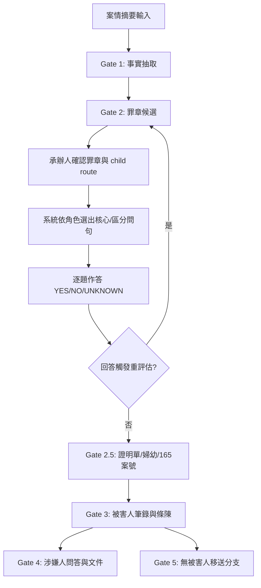

# 法律案件工作台

**獨立、本機優先**的 Gate 1–5 法律案件工作台。不復原父目錄已刪除的舊系統檔案。Gate 1 固定本機處理；Gate 2 外部 AI 預設關閉，需明確啟用且操作人員逐次同意才送出摘要。

`legal-case-web` 支援本機 loopback 與 Render Free 邀請制單人部署。核心目標是整理事實、保留多個候選法律路由、產生角色化問句及輸出筆錄；它不是自動定罪系統。

## 快速導覽

| 區塊 | 說明 |
|------|------|
| [啟動方式](#啟動方式) | 環境需求、一鍵啟動、健康檢查 |
| [核心流程](#核心流程-gate-15) | 12 步驟業務流程與 Mermaid 圖 |
| [API 端點](#api-端點) | 完整 HTTP 介面規格 |
| [法律與人工核准邊界](#法律與人工核准邊界) | 系統不做法律判斷的具體界線 |
| [Render Free 自用部署](#render-free-自用部署) | Docker Blueprint、邀請制登入、免費層與資料限制 |
| [外部 AI 邊界](#外部-ai-邊界) | 金鑰、同意機制、資料外送範圍 |
| [問句來源與優先序](#問句來源與優先序) | 6 層題庫載入順序與去重 |
| [文件規則](#文件規則) | DOCX 規格、頁數檢查、字數限制 |
| [隱私與安全](#隱私與安全) | 本機綁定、記憶體隔離、稽核不落地 |
| [專案架構與維護界線](#專案架構與維護界線) | 正式路徑、儲存實作、原型隔離、PoC 狀態 |
| [語意推理模組](#語意推理模組) | 14 個核心模組職責表 |
| [開發者指南](#開發者指南) | 切入點、常用指令、修改前核對 |

---

## 啟動方式

**需求**：Windows、Python 3、LibreOffice、`requirements.txt` 套件。

```powershell
cd D:\工作用\judicial1\legal-case-web
py -3 -m pip install -r requirements.txt
.\start.ps1
```

- 服務網址：**`http://127.0.0.1:8787/`**（僅綁定 `127.0.0.1`，不對外）
- `start.ps1` 會檢查原始碼異動並自動重啟，確保瀏覽器載入最新版本
- 健康檢查：`GET /api/health` 回傳 `{ "status": "ok", "mode": "LOCAL_ONLY", "external_ai": false, "source_mtime": <unix> }`

## Render Free 自用部署

- **服務名稱**：`legal-case-workbench`
- **線上工作台網址**：[https://legal-case-workbench.onrender.com](https://legal-case-workbench.onrender.com)
- **登入 / 首次註冊入口**：[https://legal-case-workbench.onrender.com/login](https://legal-case-workbench.onrender.com/login)
- **健康檢查端點**：[https://legal-case-workbench.onrender.com/api/health](https://legal-case-workbench.onrender.com/api/health)

專案在 Render 以既有 Dockerfile 部署。根目錄 `render.yaml` 定義 Blueprint；推送 `main` 分支會自動建置最新版本。若需手動部署：Render Dashboard → `legal-case-workbench` → **Manual Deploy** → **Deploy latest commit**。首次帳號註冊需設定至少 32 個字元的 `REGISTRATION_INVITE_CODE`。
**免費層與資料界線**：

- Free Web Service 閒置 15 分鐘後休眠；下一個請求會喚醒服務，通常需約一分鐘。每個 workspace 每月有 750 小時 Free instance 時數；休眠時數不計入。
- Free 沒有持久磁碟；本機檔案會在休眠、重新部署或重啟時遺失。帳號 SQLite 位於 `/tmp`，消失後需以保留的邀請碼重新註冊。
- 案件只存在服務程序記憶體；程序重啟後案件清除。服務有公網網址並由登入保護，不是網路層私有服務。
- 案件內容會傳送至 Render 並在服務記憶體處理；Render 是案件資料處理邊界的一部分。部署設定關閉外部 AI。
- Free instance 為 512 MB RAM、0.1 CPU；LibreOffice 產製 DOCX 可能受記憶體限制，需在 Render 實際驗證。
- 官方說明：[Blueprint](https://render.com/docs/blueprint-spec)、[Free Web Service 限制](https://render.com/docs/free)、[Docker 部署](https://render.com/docs/docker)。

---

## 核心流程



### 12 步驟

1. **輸入案情摘要** —— 僅接受自由敘述；請以「發生／查獲時間：」「發生／查獲地點：」「案情經過：」標明。未標示者保留 `UNKNOWN`，**不自行猜測**。
2. **Gate 1 事實抽取** —— 抽取中性事實。無證據支持的原持有、同意、保管、取得手段、返還約定、主觀意圖維持 `UNKNOWN`。
3. **Gate 2 罪章候選** —— 確定性規則或外部 AI（api.iamhc.cn，OpenAI 相容）提出零或多個候選；候選**不代表犯罪成立**。關聯候選僅供人工區辨。
4. **人工確認** —— 承辦人分別確認候選罪章與 child legal route，原子保存；child route 僅作為法律脈絡，狀態 `PARENT_PACK_ONLY / NONE`。
5. **問句選擇** —— 依角色與候選方向選出核心/區分問句；每題連結 `fact_target` 與 `legal_targets`。
6. **作答與重評估** —— 自由文字存為陳述；僅明確 `YES/NO/UNKNOWN` 觸發重評估；衝突維持 `NEED_REVIEW`。
7. **Gate 2 基本資料** —— 填寫受詢問人年籍、詢問起訖時間；逐題呈現（上/下一題、進度）。
8. **Gate 2.5 條件欄位** —— 依規則顯示證明單、婦幼、165 案號欄位。
9. **Gate 3 輸出** —— 產生被害人筆錄與條陳。
10. **Gate 4 延伸** —— 同案件續辦涉嫌人問答與文件。
11. **Gate 5 移送** —— 無被害人案件走移送分支。
12. **單案件隔離** —— 同瀏覽器流程可退回修正；新案件建立時前一件自記憶體移除。

---

## API 端點

> 本機模式的 API 需 `X-Session-Token`；部署後使用登入 session cookie。所有變更請求都驗證同源 `Origin`；Body ≤ 256 KB；回應使用 CSP / no-store / nosniff / frame-deny。

| 方法 | 路徑 | 說明 | 權限 |
|------|------|------|------|
| `GET` | `/api/health` | 服務狀態、模式、外部 AI、source_mtime | 公開（健康檢查） |
| `GET` | `/api/auth/status` | 登入狀態、首次註冊是否開放 | 公開（不含帳號資料） |
| `POST` | `/api/auth/register` | 以邀請碼建立唯一帳號 | Origin + 一次性註冊條件 |
| `POST` | `/api/auth/login` | 登入；錯誤嘗試達 5 次後鎖定 15 分鐘 | Origin |
| `POST` | `/api/auth/logout` | 清除目前登入 session | Origin |
| `GET` | `/api/cases` | 回傳空陣列（單案件模式） | Token / 登入 session |
| `GET` | `/api/question-bank` | 題庫版本、審核狀態、罪章清單 | Token / 登入 session |
| `GET` | `/api/cases/:id` | 取得案件公開快照 | Token / 登入 session |
| `POST` | `/api/cases` | 建立新案件 | Token / 登入 session + Origin |
| `POST` | `/api/cases/:id/actions` | 執行動作（需 `revision`） | Token / 登入 session + Origin |
| `GET` | `/api/cases/:id/documents/:role/:kind` | 下載 DOCX（`role=victim\\|suspect\\|transfer`，`kind=interview\\|brief`） | Token / 登入 session |
| `GET` | `/api/cases/:id/brief/:role` | 取得條陳純文字 | Token / 登入 session |
| `GET` | `/` `/login` `/app.js` `/auth.js` `/styles.css` `/auth.css` | 工作台或登入頁與靜態檔案 | 登入頁/資源公開；工作台需登入 |

### 錯誤代碼

| 代碼 | HTTP | 觸發情境 |
|------|------|----------|
| `INVALID_HOST` | 400 | Host 不在允許清單 |
| `INVALID_SESSION` | 401 | 本機 Token 不符 |
| `LOGIN_REQUIRED` | 401 | 部署模式缺少有效登入 session |
| `INVALID_CREDENTIALS` | 400/401 | 帳號輸入格式或登入憑證錯誤 |
| `INVALID_ORIGIN` | 403 | 非同源變更請求 |
| `REGISTRATION_REJECTED` | 400 | 邀請碼或註冊資料錯誤 |
| `REGISTRATION_CLOSED` | 409 | 唯一帳號已建立或邀請碼未設定 |
| `LOGIN_THROTTLED` | 429 | 登入錯誤達上限，暫停 15 分鐘 |
| `NOT_FOUND` | 404 | 路徑/案件不存在 |
| `REVISION_CONFLICT` | 409 | `revision` 不符（不自動重送） |
| `VALIDATION_ERROR` | 422 | 業務規則驗證失敗 |
| `DOCUMENT_BLOCKED` | 422 | 文件完整性檢核失敗 |
| `INTERNAL_ERROR` | 500 | 未預期例外（不洩漏堆疊） |

### 前端錯誤恢復（測試鎖定）

- **非 2xx**：安全解析 JSON `message`/`error`；非 JSON/HTML 統一預設訊息，**不顯示 raw body**
- **fetch 失敗**：顯示「無法連線到本機服務，請確認服務仍在執行。」，**不洩漏**瀏覽器英文錯誤
- **409 CONFLICT**：原 POST 僅嘗試 1 次，**不自動重送**；同案件時載入最新版提示重試，否則保留原版

---

## 法律與人工核准邊界

- **候選非法律判斷**：確定性規則或外部 AI 分類，皆非法律判斷
- **可安全回傳零候選**
- **候選狀態機**：`NEED_REVIEW` → `ACTIVE` / `LOWERED`（需 answer mapping）；三狀態**均不代表成立或排除**
- **題庫 `HUMAN_REVIEW_REQUIRED`**：啟動載入 `questions/` 核實 Markdown（核心/補充/補強/區分/加重分節）
- **公司範本逐字保留**：`app/company_templates.py` 三份範本必題；輸出含表頭、年籍表、應告知事項（刑訴 §95 經 §100-2 準用；移送含提審法 §1）、簽名區
- **公司套表罪章題**：`新套表.xlsm` 逐字載入（`app/xlsm_questions.py`），公式插值題跳過由承辦人補實
- **全程人工確認**：Gate 1、罪章、問句、回答確認後始可輸出
- **文件完整性門檻**：法源/程序/必要案號不足時**不得**標示完整
- **法規核對入口**（2026-10-11 twlegalrag）：
  - 刑訴法 §95、§100-2、§100-3
  - 提審法 §1
  - 個資法
- **《警察犯罪偵查手冊》**：公開全文 `UNKNOWN`，**不可宣稱**逐條核准

---

## 外部 AI 邊界

| 條件 | 規則 |
|------|------|
| **雙重啟用** | `ALLOW_EXTERNAL_AI=true` + `IAMHC_API_KEY` 同時成立 |
| **逐次同意** | Gate 2 勾選明示同意始送出 |
| **Gate 1 永不外送** | 永遠本機規則切分 |
| **傳輸範圍** | 僅 Gate 2 摘要（≤4000 字）至 `IAMHC_BASE_URL`（預設 `https://api.iamhc.cn/v1`） |
| **金鑰管理** | `.env` 中 `IAMHC_API_KEY`，已在 `.gitignore` |
| **失敗退回** | 金鑰缺失/服務失敗 → 退回規則候選；重試 4 次放棄 |
| **資料不外送** | 年籍、問答、案號、條陳**完全不送外部** |

---

## 問句來源與優先序

載入順序（`docs/QUESTION_DESIGN_AND_USE.md` §6）：

1. 公司三份 `.doc` 範本必題（`app/company_templates.py`，逐字）
2. 通用程序題（`data/question_bank.json` common）
3. 公司套表罪章題（`data/xlsm_questions.json`，跳過公式插值）
4. Markdown 核心/補充/補強/區分/加重題（`questions/*.md` 分節）
5. JSON 要件題（md 未涵蓋同 element 時補入）
6. 受控情境題（`app/questions.py`，如財物取走 7 題中性事實）

**關鍵機制**：
- 全文比對去重
- 八頁校準 97 題上限；被害人固定 19 題 → offense 題上限 78
- 公司/核心題優先保留；超過以 LibreOffice 頁數 **fail closed**
- 財物取走情境不展開延伸題；執行時保留公司題、通用題、XLSM 題 + 7 題角色化核心/區分題

---

## 文件規則

- **格式**：`.docx`（不修改舊 `.doc`）
- **結構**：標題列、詢問時間地點、案由、年籍表（11 欄+家經）、應告知事項、問答、簽名區
- **版面**：A4、標楷體 12pt、1.15 倍行距
- **頁數檢查**：LibreOffice 轉 PDF 讀取實際頁數；**>8 頁 / LibreOffice 缺失 / 排版失敗 → 阻止下載**
- **條陳長度**：≤500 Unicode 字元；超過**阻止寫入，不截斷**
- **無加密**：使用者自行依機關規定保存

---

## 隱私與安全

- 本機模式僅綁定 `127.0.0.1`；Render 使用 HTTPS 公網網址與邀請制登入。未登入者不能進入工作台或案件 API，但服務網址仍可從網際網路連線。
- CORS 關閉；所有變更請求驗證同源 `Origin`。
- 驗證依部署模式：本機 `X-Session-Token`；Render 為 `HttpOnly`、`Secure`、`SameSite=Strict` session cookie；另檢查 Host 與 Body 大小。
- 回應：CSP、no-store、nosniff、frame-deny；登入模式啟用 HSTS。
- **單案件記憶體工作區**：不顯示已保存案件、不寫入案件 SQLite；重啟不保留案件。
- Render Free 暫存 SQLite 僅保存帳號名稱、salt 與 PBKDF2 密碼雜湊；休眠、重啟或重新部署後可能需重新註冊，不保存案件資料。
- **稽核不落地**：不存姓名、案號、自由文字、問答內容。
- `CaseStore`/`DPAPI`/`SQLite` 案件儲存模組僅為相容性模組與安全測試，**非啟用功能**。

---

## 專案架構與維護界線

- **正式啟動**：`start.ps1` → `app.server` → `app.workflow` 串接規則/問句/文件
- **Runtime 儲存**：`EphemeralCaseStore`（程序記憶體單案件）；`CaseStore` 為未接線相容模組
- **原型隔離**：`web_app/` 為獨立 Next.js 原型，**非**正式啟動路徑
- **PoC 隔離**：法律檢索/罪章關聯為離線審查用途；未完成 Human Gate **不得**接入 runtime
- **證據分級**：法源可回查、測試通過、文件產出 = **工程證據** ≠ 法律核准

### 目錄結構

```
legal-case-web/
├── app/
│   ├── server.py           # HTTP 入口、安全守衛
│   ├── workflow.py         # Gate 狀態機、案件快照
│   ├── rules.py            # Gate 1、規則候選、題目整合
│   ├── questions.py        # 問句 metadata、預算、重評估
│   ├── documents.py        # DOCX 產生、頁數驗證
│   ├── storage.py          # EphemeralCaseStore / CaseStore
│   ├── acts.py             # 行為模型、競合分析
│   ├── legal_retrieval*.py # 法律檢索 PoC（離線、未接入）
│   └── *.py                # 其他支援模組
├── data/                   # Runtime JSON
├── questions/              # Markdown 題庫
├── docs/                   # 架構、設計、審查、證據封包
├── tests/                  # pytest + Node 測試
├── tools/                  # 輔助工具
└── web_app/                # Next.js 原型（獨立）
```

---

## 語意推理模組

| 模組 | 職責 | 非職責 |
|------|------|--------|
| `app/acts.py` | 行為模型、競合分析（不自動定性；竊盜/侵占含裁判錨點） | 自動認定行為數/競合結論 |
| `app/questions.py` | 問句 metadata、動態預算、條件觸發、重評估、品質檢核 | 從自由文字直接定罪 |
| `app/document_validation.py` | 筆錄/條陳完整性驗證（fail closed） | 決定罪章成立 |
| `app/law_reference.py` | 法源快照、行為時法警示 | 取代人工法律核對 |
| `app/legal_semantic_corpus.py` | 固定語意測試集（32+6 案例） | — |
| `app/offense_linkage.py` | 離線罪章關聯 PoC（竊盜/侵占 3 罪） | 接入 Gate 2、機率/自動認定 |
| `app/legal_retrieval.py` | 結構化去識別查詢、防竄改、離線 adapter | 接收全文、呼叫外部 MCP、改狀態 |
| `app/legal_retrieval_cache.py` | 正規化 metadata、hash scope、兩層完整性、原子寫入 | 存全文/節錄/個資、預設快取 |
| `app/legal_provider_fixtures.py` | 離線 fixture 契約驗證、無公開 schema 鎖 discovery | 發請求、猜測 schema、清快取、接入 |
| `app/legal_retrieval_reconciliation.py` | Registry 映射 locator、原子移除 metadata、tombstone | 模糊匹配、存原始 locator、恢復、接入 |
| `app/legal_retrieval_sync.py` | 協調器（dry-run）、adapter/正規化/cache/移除 | 外部網路、身分不一致、預設 cache、接入 |
| `app/legal_retrieval_batch.py` | Manifest 驗證、記憶體 transaction、單次原子提交 | 部分提交、忽略漂移、存案件、排程、接入 |
| `app/legal_retrieval_replay.py` | Golden corpus 重播、allowlist、固定投影與 hash | 收案件資料、輸出 fixture/錯誤文、覆寫、宣稱驗收 |

**關鍵資料**：
- `data/offense_linkage_poc.json`：法條/裁判錨點/child route/區分軸/中性問句關聯；`runtime_enabled: false / HUMAN_REVIEW_REQUIRED`；起訴書 `NOT_INGESTED`
- `docs/evidence/legal_retrieval_human_gate_packet.json`：10 核心檔案 + 4 runtime hash 凍結；`PENDING_HUMAN_APPROVAL`，**hash 漂移即失效**
- `docs/evidence/hg_lr_01_provider_contract_review.json`：5 provider 盤點；`PARTIAL_REVIEW_HUMAN_APPROVAL_REQUIRED`，**不選定/不授權 live**
- `docs/evidence/hg_lr_02_privacy_security_review.json`：query/boundary/cache/audit/報告流；`CHANGES_REQUIRED_HUMAN_APPROVAL_PENDING`，**不得啟用外部/正式 cache**

---

## 法源核實現況

- 44 啟用路由均有法源紀錄、crosswalk、≥1 child route
- 310 待人工審查 legal routes
- `VERIFIED_CURRENT` = 僅主要法源可回查，**不含**全罪名/特別法/行為時法/問句審查
- 6 `PARTIAL_SCOPE` 路由（如 `public_danger` 僅酒毒駕+逃逸）
- 候選輸出 fail closed；行為時間早於修正日記錄 `temporal_law_warnings`

---

## 問句生成管線

```
公司必問 → 通用題 → 公司罪章題 → md 題 → JSON 要件題 → metadata 豐富化 → 品質檢核（Q1-Q10）
```
- `core`/`company_offense` **不得**為頁數靜默裁切
- 必要題超預算 → **fail closed**，要求縮小路由範圍

---

## 品質審查三層關

1. 生成時程式化檢核（Q1-Q10）
2. pytest 品質測試集（誘導/定性語句掃描）
3. 承辦人人工審核（題庫變更時）

---

## 驗證與測試

```powershell
# 完整測試
py -3 -X utf8 -m pytest -q
node --check app\static\app.js
```

### 最近驗證（2026-10-19）

- **364 passed**（pytest）
- `node --check`、`compileall`、`git diff --check` 通過
- Next.js production build + ESLint 通過
- Prototype `npm audit --audit-level=moderate`：**0 vulnerabilities**
- Edge 實測三分支：
  - 被害人：35 題
  - 涉嫌人續辦：33 題
  - 無被害人移送：28 題
- 響應式：桌面/768px/375px 無水平溢位
- **外部 AI 未實際呼叫**；以上為工程/操作證據，**不代表**法律完整/視覺基準/Human Gate 通過

### 覆蓋重點

零候選、AI 解析/退回、關聯候選、單一判斷、公司必問逐字、XLSM 載入、權利/提審告知、案號條件、500 字、Gate 禁止跳過、年籍、向後修改失效、被害人→涉嫌人、無被害人、記憶體隔離、revision 衝突、DOCX 完整性、LibreOffice 頁數、Token/Host/Origin/CSP/CORS/路徑穿越、前端 409 安全回載、DPAPI/SQLite 相容模組安全測試

---

## 開發者指南

### 核心邏輯切入點

| 目標 | 起始檔案 |
|------|----------|
| 新增/修改罪章路由 | `data/question_bank.json`、`data/legal_route_crosswalk.json` |
| 調整問句選擇邏輯 | `app/rules.py`、`app/questions.py` |
| 修改 Gate 狀態流轉 | `app/workflow.py` |
| 文件輸出格式/驗證 | `app/documents.py`、`app/document_validation.py` |
| 新增題庫來源 | `app/markdown_questions.py`、`app/xlsm_questions.py` |
| 法律檢索 PoC | `app/legal_retrieval*.py`、`data/offense_linkage_poc.json` |

### 常用指令

```powershell
# 單一測試檔
py -3 -X utf8 -m pytest tests/test_rules.py -q

# 關鍵字過濾
py -3 -X utf8 -m pytest -k "gate2" -q

# 覆蓋率
py -3 -X utf8 -m pytest --cov=app --cov-report=term-missing

# 前端開發（獨立）
cd web_app && npm run dev
```

### 修改架構前必確認（六大原則）

1. Runtime entrypoint 確實可達
2. 公司題/XLSM/Markdown/JSON **載入順序**保持
3. Gate 核准與 revision conflict 仍 **fail closed**
4. 新欄位**向後相容**
5. RCQ review-only 資料**仍隔離**
6. 測試綠燈 = **工程證據**，非法律驗收

---

## 版本與授權

- 內部工作台，**不對外發布授權**
- 部署/外部同步/正式案件使用 = 不同授權範圍；本文件不授權部署
- API 金鑰不得進瀏覽器、題庫、文件、log、版控

---

## 相關文件

| 檔案 | 用途 |
|------|------|
| `docs/SYSTEM_ARCHITECTURE.md` | 架構、元件責任、資料邊界、信任模型 |
| `docs/QUESTION_DESIGN_AND_USE.md` | 問句設計規約、載入順序、品質檢核細則 |
| `docs/LAW_REGISTRY.md` | 法規身分、別名、版本線索、route 關聯 |
| `docs/LAW_LIFECYCLE.md` | 新增/更新法規查證、分類、影響分析 |
| `docs/OFFENSE_QUESTION_WORK_QUEUE.md` | Routes 工作範圍與狀態追蹤 |
| `docs/CRIMINAL_OFFENSE_ROLE_CORE_QUESTIONS_ALL.md` | 全罪章角色核心題審查稿（`RUNTIME_ENABLED=False`） |
| `docs/QUESTION_WORK_ITEM.md` | 單一問句工作項目契約 |
| `docs/LIFECYCLE_RECORD.md` | 版本生命週期記錄 |
| `docs/REFERENCE_STANDARD_LIBRARY.md` | 參考標準庫清單 |
| `docs/evidence/*.json` | Human Gate 證據封包（凍結 hash、審查狀態） |

---

> **最後更新**：2026-10-20  
> **維護原則**：文件先行、邊界明確、證據可追溯、測試為工程證據而非法律核准