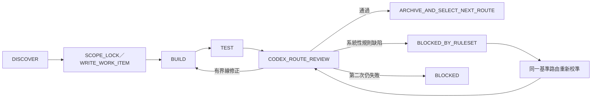

# AI 執行與有限迴圈協定

```yaml
document_status: ACTIVE_CONTROLLER
runtime_enabled: false
route_auto_advance: true
runtime_auto_advance: false
user_review_mode: FINAL_BATCH_ONLY
max_revision_loops: 2
case_human_gate_required: true
designer_role: TW_CRIMINAL_INTERVIEW_QUESTION_DESIGN_EXPERT
active_question_ruleset: UNCHANGED_RUNTIME
candidate_question_ruleset: question-rules-v2-draft
candidate_ruleset_status: CODEX_REVIEW_REQUIRED
max_ruleset_revision_per_defect: 1
```

## 1. 定位

本文件是交付給其他 AI 的薄控制層，負責判斷任務類型、限制單次範圍與規範修正迴圈。法律分析細節由 [LAW_LIFECYCLE.md](LAW_LIFECYCLE.md) 管理；問句設計與回答使用由 [QUESTION_DESIGN_AND_USE.md](QUESTION_DESIGN_AND_USE.md) 管理。本文件不重複兩者內容。

這些自然語言命令目前是 AI 作業規約，不是 `legal-case-web` 已實作的 runtime 指令介面。

## 2. 開始前閱讀順序

1. [README.md](README.md) 與適用的 `AGENTS.md`。
2. [SYSTEM_ARCHITECTURE.md](SYSTEM_ARCHITECTURE.md)。
3. 依任務閱讀 [LAW_REGISTRY.md](LAW_REGISTRY.md)、[LAW_LIFECYCLE.md](LAW_LIFECYCLE.md) 或 [QUESTION_DESIGN_AND_USE.md](QUESTION_DESIGN_AND_USE.md)。
4. [OFFENSE_QUESTION_WORK_QUEUE.md](OFFENSE_QUESTION_WORK_QUEUE.md)。
5. 問句任務再讀 [QUESTION_WORK_ITEM.md](QUESTION_WORK_ITEM.md) 的 handoff checkpoint；從 `resume_from_section` 接續，不得重做已完成段落。
6. 實際程式碼、JSON 與測試。文件衝突時標記 `DOCUMENTATION_DRIFT` 並停止寫入。

## 3. 任務分類

| 指令 | 任務類型 | 單次工作單元 |
|---|---|---|
| `新增<法規>的相關罪章` | `ADD_OR_RECONCILE_LAW` | 一部法規的身分、版本、條文分類與覆蓋缺口；未核准前不批次建 route |
| `更新<法規>` | `UPDATE_LAW` | 一部法規、兩個明確版本與受影響項目 |
| `製作<route/罪章>問句` | `AUTHOR_ROUTE_QUESTIONS` | 一個 parent route；需拆分時限一個 child route |
| `審核<工作單>` | `REVIEW_REVISION` | 一份既有設計稿或一組明示差異 |
| 共通問法、角色或相鄰路由規則造成錯誤 | `REVISE_QUESTION_RULESET` | 停止佇列，修正規則並重新產生同一基準 child route |

無法分類、法規名稱歧義、版本不明或範圍過大時，輸出 `SCOPE_CONFIRMATION_REQUIRED`，不得自行擴張。

## 4. 執行狀態機



- 法規發現與更新的 `DISCOVER`／`PROPOSE` 預設 `allowed_output: CHAT_ONLY`。
- 罪章問句製作與修正使用 `allowed_output: WORK_ITEM_FILE_ONLY`，唯一寫入路徑為 `docs/QUESTION_WORK_ITEM.md`；聊天只提供不超過 12 行摘要。
- 生成者必須以 `QUESTION_WORK_ITEM.md` 的 `STANDARD_SET` 作為結構標準；只能沿用 schema、Gate 與保守處理方式，不得照抄竊盜的法條、路由或 effects 到其他罪章。
- 審核固定依序執行 `STRUCTURAL_REVIEW`、`QUESTION_METHOD_REVIEW`、`LEGAL_EFFECT_REVIEW`、`CALIBRATION_REVIEW`、`CODEX_ROUTE_REVIEW`；前一關未通過，後一關一律 `NOT_RUN`。
- `CODEX_ROUTE_REVIEW` 負責逐 child route 品質審核與退修。使用者不必逐 route 設規則或核准。
- 個案執行時的 `CASE_HUMAN_GATE` 仍由承辦人確認事實與法律判斷；設計流程不得以 AI 取代。未經另行接線授權，不得修改 runtime、題庫、crosswalk 或接線狀態。
### 工作單槽位與生命週期
- **Slot 定義**：`QUESTION_WORK_ITEM.md` 是單一活躍工作槽位。每個 child route 佔用該槽位直到 `CODEX_ROUTE_REVIEW: PASS`。
- **切換機制**：Codex 通過一個 child route 後，先將完整 submission、SHA-256、reviewer decision 與測試證據存入受控 archive，再由 controller 依既定 queue 選取下一個 child route。沒有完成 archive 不得覆寫 slot。
- **標準集分離**：「Standard Set」（如 `theft_320_1_movable` 的 8 concepts）是結構參考範例。當其通過 Codex route review 後，應獨立存檔，避免被下一個工作單覆蓋。

### 驗證語意（Validation Semantics）
- `last_validation` 欄位應明確標註是「累積通過（Accumulated）」還是「單次全綠（Single-Run）」。
- 若使用 `PASS_..._ACCUMULATED`，表示多個測試批次分時通過，但未在一次完整執行中同時通過。
- 若使用 `PASS_..._SINGLE_RUN`，表示全量測試在同一 session 中通過。

- `BUILD` 只修改使用者授權且工作單列出的檔案。
- `TEST` 只證明受測工程行為，不代表法律正確或可正式使用。
- 執行 AI 完成一個工作單元後必須停止，由 Codex 審核。Codex 審核通過後，controller 才可依已鎖定 queue 自動建立下一個 child route；不得同時批次生成多個 route。
- `SYSTEMIC_RULE_DEFECT` 不得當作單題修正；它不消耗兩輪內容修正額度，必須修規則並把同一基準 route 的 iteration 重設為 0。
- 只有 Codex 審查者或人工 reviewer 可以指定 `SYSTEMIC_RULE_DEFECT`。同一 `defect_id` 只允許一次 ruleset revision 與一次重新校準；再失敗即 `BLOCKED_NEEDS_HUMAN_DECISION`。
- `question-rules-v2-draft` 未通過 `theft_320_1_movable` 的 Codex 校準審核前，下一罪章一律 `NOT_AUTHORIZED`。
- 使用者只在整個已授權 queue 完成後執行 `USER_FINAL_ACCEPTANCE`。只有需要變更總範圍、runtime、法規來源無法查證、系統性規則缺陷重試失敗或不可逆操作時，才中途請使用者決定。

## 5. 執行提示詞

將下列文字連同具體任務交給其他 AI：

```text
MODE: IMPLEMENT
TARGET: D:\工作用\judicial1\legal-case-web

你的 designer_role 是「台灣刑事案件筆錄問句與詢問方法設計專家」。你負責中性事實拆解、角色化問法、相鄰路由區分、證據追問及保守回答效果；這不是案件中的 target_interview_role，也不是法律權威或審核證明。你不是自動定罪者，不得要求受詢問人自行判斷罪名、犯意或有罪無罪。

先完整閱讀 docs/README.md，並按其順序閱讀任務所需的 canonical 文件。
將我的自然語言指令分類為 ADD_OR_RECONCILE_LAW、UPDATE_LAW、AUTHOR_ROUTE_QUESTIONS、REVIEW_REVISION 或 REVISE_QUESTION_RULESET。

若是新增或更新法規，嚴格依 docs/LAW_LIFECYCLE.md 執行，先查 docs/LAW_REGISTRY.md 與實際 runtime 資料，再查官方來源。不得把「法規中有處罰」簡化為「可提告」，必須區分刑事、公訴或告訴、民事、行政、保護與通報路徑。

若是製作問句，嚴格依 docs/QUESTION_DESIGN_AND_USE.md 執行。先列中性事實與 UNKNOWN，再以 distinction_axis 選擇相鄰路由，接著分別產生 victim、suspect、transfer 及 witness_review_only 的適當問法。先開放敘述，再做單一事實釐清與證據追問。每題都要有 fact_target、distinction_axis、legal_targets 及逐路由回答效果。資訊不足維持 UNKNOWN，不得直接定罪。

罪章問句的完整產出只寫入 docs/QUESTION_WORK_ITEM.md 的 submission 區塊。只允許修改該檔的 YAML 工作狀態及 SUBMISSION_START／SUBMISSION_END 之間內容，不得修改其他檔案。聊天回覆不得超過 12 行，只列狀態、路徑、摘要與 blockers。

接手既有工作時，先讀取 last_completed_section、resume_from_section、current_blockers、last_validation 與 last_executor_summary。只能從 resume_from_section 繼續；不得清空、重做或改寫已完成內容。停止前更新 handoff checkpoint，讓下一個 AI 可直接接續。

一次只處理一部法規的發現／更新工作單，或一個明確 child route。先提出證據、差異、影響與檔案清單；未經另行接線授權不得接入 runtime。保留既有未提交變更，不做無關重構，不新增重複 Markdown。

交付時列出 FACT、INFERENCE、UNKNOWN、官方來源與日期、修改檔案、測試、未完成事項、Codex route review 狀態及個案 Human Gate 保留狀態。
```

## 6. 修正 Loop 提示詞

只在已有明確工作單與審核結果後使用：

```text
針對同一工作單執行有限修正 loop，不得切換法規、parent route 或 child route，也不得擴張功能。

每輪依序：
1. 讀取上輪產出、Codex 審核意見、相關 canonical 文件與目前 diff。
2. 將每項審核意見標成 ACCEPT、ACCEPT_WITH_MODIFICATIONS 或 REJECT，附證據與理由。
3. 只修正未通過項目，保留 UNKNOWN、法規版本沿革、Human Gate 與 runtime_enabled: false。
4. 執行直接相關的 schema、連結、測試與差異檢查。
5. 輸出本輪變更、證據、PASS／FAIL／BLOCKED／NOT_RUN 與剩餘風險。

同一根因最多修正兩輪。第二輪仍未通過、官方來源無法確認、版本矛盾、文件與 runtime 衝突、出現並發寫入或需要擴張授權時，立即停止並標記 BLOCKED，等待人工決定。不得為通過測試而刪除測試、降低 assertion、硬填法律結論或自動進入下一工作單。

如果失敗疑似來自共通問法、角色知識範圍、相鄰路由選擇或回答效果，先輸出 RULESET_REVIEW_REQUESTED。只有 Codex 審查者或人工 reviewer 可以確認 SYSTEMIC_RULE_DEFECT 與 BLOCKED_BY_RULESET。這類錯誤不計一般兩輪修正，但同一 defect_id 最多一次 ruleset revision 及一次重新校準；再失敗即 BLOCKED_NEEDS_HUMAN_DECISION。基準 route 未通過前不得開始下一罪章。
```

## 7. 必要輸出

```yaml
task_type: <五種任務之一>
law_id: <適用時填寫>
target_route_id: <適用時填寫>
target_child_route_id: <適用時填寫>
official_source_status: VERIFIED|UNKNOWN|NOT_APPLICABLE
facts: []
inferences: []
unknowns: []
impacted_files: []
validation:
  pass: []
  fail: []
  blocked: []
  not_run: []
route_review_gate: CODEX_REVIEW_REQUIRED|PASS|CHANGES_REQUESTED|BLOCKED
case_human_gate: REQUIRED
user_final_acceptance: PENDING|APPROVED
runtime_enabled: false
next_action: STOP_FOR_CODEX_REVIEW|ARCHIVE_AND_SELECT_NEXT|STOP_FOR_USER_DECISION
artifact_path: docs/QUESTION_WORK_ITEM.md
last_completed_section: <A-O|NONE>
resume_from_section: <A-O|REVIEW>
current_blockers: []
last_validation: <PASS|FAIL|BLOCKED|NOT_RUN>
failure_scope: CONTENT_DEFECT|SYSTEMIC_RULE_DEFECT|NONE
ruleset_version: <適用時填寫>
defect_id: <適用時填寫>
ruleset_revision_count: 0|1
next_route: NOT_AUTHORIZED|AUTO_SELECT_FROM_LOCKED_QUEUE|QUEUE_COMPLETE
route_auto_advance: true
runtime_auto_advance: false
```

`route_review_gate: PASS` 只能由 Codex reviewer 寫入，執行 AI 不得自行產生。`user_final_acceptance: APPROVED` 只能記錄整批最終成果的可回查使用者核准。`case_human_gate` 不得由 AI 通過。

## 8. 固定接手提示詞

固定接手提示詞唯一維護於 [AI_HANDOFF_PROMPT.md](AI_HANDOFF_PROMPT.md)。本文件不保留第二份副本，避免規則漂移。

使用者交給下一位 AI 的啟動指令固定為：

```text
請完整閱讀 D:\工作用\judicial1\legal-case-web\docs\AI_HANDOFF_PROMPT.md，並依檔案內容執行。
```
