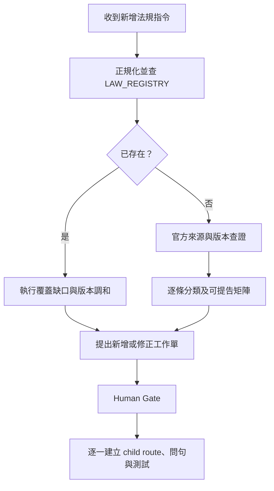

# 法規新增與更新生命週期

```yaml
document_status: ACTIVE_GOVERNANCE
runtime_enabled: false
jurisdiction_default: TW
human_gate_required: true
```

## 1. 文件目的與邊界

本文件規範 AI 收到「新增某法相關罪章」或「更新某法」時的分析與交付流程。它是維護規約，不代表目前應用程式已具備自然語言命令解析、官方法規自動比對或自動寫入題庫的功能。

所有外部法規內容都必須以當次可回查的官方來源驗證。無法確認時保留 `UNKNOWN`；不得以記憶、搜尋摘要或既有題庫宣稱現行法。

## 2. 命令分類

| 使用者輸入模式 | 任務類型 | 初始行為 |
|---|---|---|
| `新增<法規名稱>的相關罪章` | `ADD_OR_RECONCILE_LAW` | 正規化名稱，先查登錄與 runtime，再決定新增或補缺 |
| `更新<法規名稱>` | `UPDATE_LAW` | 查明既有版本、官方現行版本與生效日，再建立差異及影響清單 |
| 其他模糊指令 | `UNKNOWN_COMMAND` | 不修改資料；列出需要確認的法規名稱或範圍 |

法規名稱查找順序：`law_id` → 正式名稱 → 別名 → 官方法規代碼 → 官方來源。只比對顯示名稱不足以判斷是否已存在。

## 3. 共用查核入口

每次新增或更新都依序執行：

1. 將名稱正規化，確認管轄地、法規層級及使用者所指版本。
2. 查閱 [LAW_REGISTRY.md](LAW_REGISTRY.md)，確認法規身分、別名、版本與關聯路由。
3. 查閱 `data/question_bank.json`、`data/legal_route_crosswalk.json`、`data/law_reference_cache.json` 與既有問句，確認實際 runtime 覆蓋。
4. 以官方法規資料庫或主管機關來源查證法規全文、修正日期、公布日期、生效日及歷史版本。
5. 完成外部資料三格查證卡：
   - 問句：管轄地、法規、版本與行為時間是否明確。
   - 證據：官方來源、查詢日期、條文與版本是否可回查。
   - 痕跡：查詢條件、差異及結論能否由第三人重現。
6. 任一關鍵欄位無法確認時標記 `UNKNOWN`，不得進入自動接線或現行法宣稱。

文件登錄與 runtime 衝突時，狀態為 `DOCUMENTATION_DRIFT`，停止寫入並交由人工判斷；runtime JSON 仍是產品行為的直接來源。

## 4. 條文分類與「可以提告」分析

不得把「法規中有處罰」直接等同於「可提出刑事告訴」。每個相關條文至少分類為下列一種：

| 分類 | 說明 |
|---|---|
| `SUBSTANTIVE_OFFENSE` | 刑事實體犯罪與構成要件 |
| `MIXED` | 同時含刑事、行政、保護或程序效果 |
| `COMPLAINT_REQUIREMENT` | 告訴乃論、告訴權人、期間或撤回效果 |
| `PROSECUTION_PROCEDURE` | 公訴、調查、移送或其他程序規則 |
| `PROTECTIVE_MEASURE` | 保護令、安全計畫、通報或轉介 |
| `CIVIL_REMEDY` | 損害賠償、回復原狀或其他民事請求 |
| `ADMINISTRATIVE_SANCTION` | 罰鍰、停業、廢止或主管機關處分 |
| `DEFINITION_REFERENCE` | 定義、準用或引用其他法規 |
| `UNKNOWN` | 現有證據不足以可靠分類 |

對使用者所說「有哪些可以提告」，交付時以矩陣回答：

```yaml
article: <條號與版本>
criminal_penalty: YES|NO|UNKNOWN
prosecution_type: PUBLIC_PROSECUTION|COMPLAINT_REQUIRED|MIXED|UNKNOWN
complaint_holder: <可回查內容或 UNKNOWN>
complaint_period: <可回查內容或 UNKNOWN>
civil_remedy: YES|NO|UNKNOWN
administrative_remedy: YES|NO|UNKNOWN
protective_or_reporting_path: YES|NO|UNKNOWN
source: <官方 URL、版本與查詢日期>
```

此矩陣只描述法規路徑，不判斷個案犯罪成立。

## 5. 新增法規流程



### 5.1 已存在

不得建立重複 `law_id`。改做下列缺口分析：

- 是否缺少別名、官方代碼、版本或生效期間。
- 是否有未登錄的刑事、程序、民事、行政或保護條文。
- 是否有條文已登錄但沒有 route、問句、測試或 Human Gate 狀態。
- 是否有 route 使用過時或不同版本的法源。

### 5.2 尚不存在

第一輪只產生 `LAW_DISCOVERY_DRAFT`，內容必須包含：

- 法規身分與官方來源。
- 版本、生效期間及已知歷史版本。
- 逐條分類與「可以提告」矩陣。
- 建議 parent route、child route、相鄰路由與非刑事流程。
- 待確認事項、風險與 `UNKNOWN`。

經人工核准範圍後，才可一次處理一個 child route；問句製作必須遵守 [QUESTION_DESIGN_AND_USE.md](QUESTION_DESIGN_AND_USE.md)。所有新內容初始為 `DESIGN_DRAFT`、`runtime_enabled: false`、`HUMAN_REVIEW_REQUIRED`。

## 6. 更新法規流程

更新前先固定「既有版本」與「官方目標版本」，再逐條建立差異。不得直接用最新文字覆寫舊版本。

| 差異狀態 | 意義 |
|---|---|
| `UNCHANGED` | 文字與法律效果無實質差異 |
| `ADDED` | 新增條文或項款 |
| `MODIFIED` | 文字或法律效果變更 |
| `RENUMBERED` | 條號移動，須保留前後沿革 |
| `SPLIT` | 一條拆成多條或多個路由 |
| `MERGED` | 多條合併 |
| `REPEALED` | 已廢止，仍保留歷史與行為時法用途 |
| `FUTURE_EFFECTIVE` | 已公布但尚未生效，不得取代現行版本 |
| `UNKNOWN` | 無法可靠比對 |

每一項實質差異都要檢查：

- `LAW_REGISTRY.md` 的版本與沿革。
- `data/legal_route_crosswalk.json` 的條文與 child route。
- `data/question_bank.json` 與 Markdown 問句的 element、`fact_target`、`legal_targets`。
- 候選路由增加、降低或排除條件。
- 告訴、公訴、期間、保護、通報、民事與行政流程。
- 測試、文件及人工審查工作表。

受影響項目先降級為 `HUMAN_REVIEW_REQUIRED`；只有官方版本、生效日、問句影響與測試都核准後，才可恢復原狀態。

## 7. Gate 與交付狀態

| Gate | 通過條件 | 未通過結果 |
|---|---|---|
| `L1_IDENTITY` | 法規身分、管轄地與別名可辨識 | `LAW_IDENTITY_UNKNOWN` |
| `L2_OFFICIAL_SOURCE` | 官方來源、版本與日期可回查 | `SOURCE_NOT_VERIFIED` |
| `L3_CLASSIFICATION` | 相關條文均已分類或明列 `UNKNOWN` | `CLASSIFICATION_INCOMPLETE` |
| `L4_IMPACT` | routes、問句、流程與測試影響已列出 | `IMPACT_UNKNOWN` |
| `L5_HUMAN_APPROVAL` | 人工核准實作範圍與版本 | `HUMAN_REVIEW_REQUIRED` |

任何 Gate 未通過都不得宣稱已新增、已更新或符合現行法。Human Gate 不得由 AI 自動通過。
