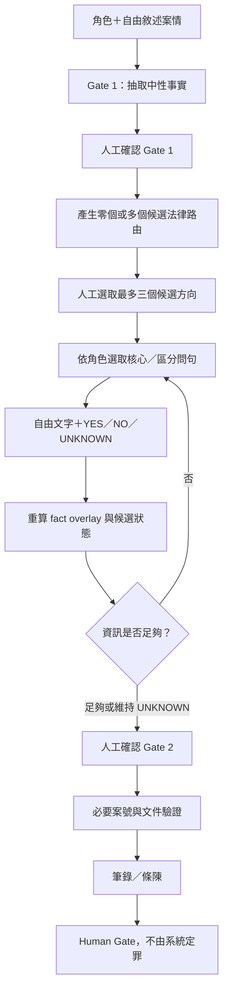

# 案件推理、候選路由與筆錄問句規範

```yaml
document_status: CANONICAL
runtime_enabled: false
scope: case reasoning, candidate routing, question design, answer reevaluation, Human Gate
does_not_cover: law discovery and version update
active_question_ruleset: UNCHANGED_RUNTIME
candidate_question_ruleset: question-rules-v2-draft
candidate_ruleset_status: CODEX_REVIEW_REQUIRED
calibration_status: CALIBRATION_REQUIRED
required_author_role: TW_CRIMINAL_INTERVIEW_QUESTION_DESIGN_EXPERT
```

本文件是案件處理與問句設計的單一規範。法規新增、修法比對及版本管理另見 [LAW_LIFECYCLE.md](LAW_LIFECYCLE.md)。

執行本文件的 AI 必須採用「台灣刑事案件筆錄問句與詢問方法設計專家」角色。其工作是把陳述轉成可查證的中性事實、依受詢問者知識範圍設計問法、用區分軸比較候選路由及保留證據來源；不得扮演自動定罪者，也不得要求受詢問者自行作法律評價。這個 `designer_role` 只是題目設計者 persona，不是案件中的 `target_interview_role`，也不是法律權威或審核通過證明。

`question-rules-v2-draft` 是待校準規則，不是已生效的 runtime 規則。它只能用於本文件第 12 節的基準路由草案；未通過 Codex route review 前，不得用它產生下一罪章正式工作單，也不得改稱 `question-rules-v2`。

## 1. 核心流程與不可跨越的邊界



- 前端採案情優先，避免誘導及過早定性。
- 後端採罪章覆蓋，避免漏問構成要件。
- 候選路由是待查方向，不是犯罪結論。
- 零候選是合法結果。不得硬套最接近的罪章。
- `UNKNOWN` 是有效狀態。不得為了產生罪章而補造事實。

## 2. Runtime Gate 與狀態

| 狀態 | 可執行事項 | 進入下一狀態的 Gate |
|---|---|---|
| `GATE1_REVIEW` | 檢查、修正中性事實 | 明確 `approve_gate1` |
| `GATE2_QA` | 選候選、填年籍、回答問句、重評估 | 所有題目有回答並明確 `approve_gate2` |
| `CASE_NUMBERS` | 填寫適用的證明單、婦幼或 165 案號 | 必要欄位完整 |
| `OUTPUT_READY` | 產生文件、開始同案其他角色或重新開啟 | 文件驗證及人工操作 |

向前修改會使後續核准與文件失效。重新開啟案件時保留舊快照，但舊核准不得冒充目前核准。

## 3. 中性事實、候選與相鄰路由

### 3.1 中性事實

只抽取可由陳述或證據確認的事項，例如行為人、行為、客體、持有、同意、取得依據、手段、返還、處分、結果與證據來源。

以「他把我的手機拿走了」為例，可以辨識對方、取走行為及手機客體；原持有、同意、保管、暴力脅迫、返還約定及主觀意圖仍為 `UNKNOWN`。

不得直接把「有犯意」「不法所有意圖」「屬於詐術」「構成某罪」寫成中性事實。

### 3.2 Parent route 與 child route

章級 route 如果包含不同犯罪、加重事由、程序條件、定義或刪除條文，必須透過 `data/legal_route_crosswalk.json` 拆分。

- `SPLIT_REQUIRED`：不得製作整章問卷，必須指定 child route。
- `PARTIAL_SCOPE`：只能處理 crosswalk 已明列範圍。
- `PROCEDURAL_ONLY`：不得當作實體犯罪候選。
- `PROTECTIVE_UMBRELLA`：先處理安全與保護流程，實體犯罪回到對應 route。

### 3.3 相鄰路由與替代方向

相鄰路由必須由「同一中性事實會造成不同法律評價」的區分軸選出，不得只依罪章名稱、關鍵字、parent route 的 `related` 清單或語意相似度擴張。

每一個 distinguishing 問句在產生前，必須先列出：

1. `fact_target`：要確認的單一中性事實。
2. `distinction_axis`：該事實區分的法律方向。
3. `candidate_a` 與 `candidate_b`：至少兩個會受影響的候選或替代方向。
4. `observable_basis`：受詢問者可以親自陳述的具體行為、言詞、文件或狀態。
5. `unknown_effect`：無法確認時一律維持 `NEED_REVIEW`。

只有背景價值、不能改變候選評估的問題，不得標成 distinguishing。同一題的 `legal_targets` 只能包含確實受該 `fact_target` 影響的路由，不得把所有相鄰財產罪或整章 child routes 全部放入。

每個工作單必須由人工先提供 `route_scope`：

```yaml
route_scope:
  primary_route: <current child route id>
  allowed_comparison_routes: [<existing child route ids>]
  allowed_alternative_routes: [<non-offense labels>]
```

- `distinction_axis` 只能從 `allowed_comparison_routes` 選取既有 route，不得自行發現、建立或加入新罪章。
- 不在 allowlist 的 route 必須輸出 `ROUTE_SCOPE_EXPANSION_REQUIRED` 並停止，不得靜默加入 `legal_targets`。
- `allowed_alternative_routes` 不是 offense candidates，不得混入犯罪候選或產生定罪效果。
- `allowed_alternative_routes` 是為相容既有工作單而保留的歷史欄位名稱；其中項目是 review target，不是 legal route，也不計入 crosswalk coverage。
- `legal_targets` 是問題效果範圍，不是擴張工作授權。
- 非罪章替代方向不得放入 `legal_targets` 或 `legal_target_details`；如需保留比較資訊，只能放入 `alternative_target_details`。
- `alternative_target_details` 的 `route_id` 必須出現在同一 ruleset version 的 `allowed_alternative_routes`，不得與正式 child route 重複；未知、重複或未列入 allowlist 時一律 fail closed。
- `alternative_target_details` 的所有答案效果只能是 `NEED_REVIEW`，且必須固定 `candidate_eligible: false`、`routing_eligible: false`、`question_generation_eligible: false`、`template_activation_eligible: false`、`effect_executable: false`、`exclusion_safe: false`、`human_review_required: true`。
- 替代審查議題不得補足 legal target coverage，不得觸發候選路由、專用問句、專用模板、案號條件、罪章排除或法律結論，也不得描述為已成立的民事效果。

以財物取走為例：

| 區分軸 | 主要比較方向 |
|---|---|
| 取得前是否因借用、保管、業務等原因合法持有 | 竊盜／普通侵占／業務侵占 |
| 物品是否為遺失物或已離開本人持有 | 竊盜／侵占遺失物 |
| 是否同意及同意範圍 | 竊盜／借用、保管或民事占有爭議 |
| 取得時是否有拉扯、暴力、威脅或使人不能抗拒的方法 | 竊盜／搶奪／強盜 |
| 是否約定返還及後續如何處分 | 竊盜／侵占／民事占有爭議，並供人工評價主觀要件 |
| 是否出現侵入、毀越、兇器、結夥或其他法定加重事實 | 普通竊盜／加重竊盜 |

民事占有爭議等非刑事方向放在 `alternative_routes`。它不是 offense，也不是民事關係成立的結論。

## 4. 角色限制

| 角色 | 可以詢問 | 不得詢問 |
|---|---|---|
| `victim` | 本人同意、認知、持有變化、受影響結果、證據來源 | 行為人未表達的內心意圖 |
| `suspect` | 取得依據、本人認知、處分／返還、有利不利資料 | 預設有罪的法律自評 |
| `transfer` | 與 suspect 相同的實體事實，另有移送程序資訊 | 把移送或既有筆錄當成構成要件 |
| `witness_review_only` | 親自看見、聽見、製作或取得的資料及觀察條件 | 被害人或涉嫌人未向其表達的主觀狀態 |

`witness` 目前不是 server/document runtime role，只能維持 review-only。

### 4.1 先敘述、再釐清

問句原則上分三層：

1. 開放敘述：讓受詢問者先用自己的話說明經過。
2. 單一事實釐清：一次確認一個 `fact_target`。
3. 證據追問：確認訊息、錄影、證人、文件或物品來源。

不得一開始連續使用暗示答案的是非題。不得在同一題同時詢問同意、返還、暴力或後續處分等不同事實。每題必須容許不知道、不確定、忘記、不理解或拒答。

### 4.2 角色化不是換稱謂

- `victim`：詢問本人持有、同意、認知、所見所聞、受影響結果及證據；不得推測行為人未表達的想法。
- `suspect`：詢問取得依據、權利認知、使用／保管／返還／處分及有利不利資料；不得使用「你為什麼偷」等預設有罪問法。
- `transfer`：實體部分接近 suspect，另問移送來源、查獲、既有筆錄、扣押及權利告知；移送事實不得當成構成要件。
- `witness_review_only`：只能詢問親自見聞、觀察條件及親自製作／取得的資料。除非親自聽見，不得代答他人同意或內心意圖。

同一 `fact_target` 可以有多個角色版本，但每一版本都必須獨立檢查該角色是否有能力回答。`target_role: ALL` 只是範圍宣告，不能取代實際角色化成果。
- `witness_review_only` 僅作為「審查基準」與「人工對照」使用，其問句 variants 不得接入 runtime 邏輯；其存在目的是為了定義該事實是否可由第三方見聞證明，而非為了在程式中執行詢問。

| target_interview_role | 可合理知悉 | 不得預設 | 同一 `original_possession` 的中性問法示例 |
|---|---|---|---|
| `victim` | 自己如何持有、保管、使用及表達同意 | 所有權必然成立、對方內心意圖 | 物品被移動前，你最後看見它由誰實際保管或使用？ |
| `suspect` | 自己取得、使用、返還、處分及權利認知 | 被害人陳述為真、自己有罪 | 你接觸或移動物品前，你所知道的保管或使用情形為何？ |
| `transfer` | 同 suspect 的本人事實，加上查獲與移送程序 | 移送或既有筆錄等於構成要件 | 你被查獲前，該物品如何由何人保管或使用？ |
| `witness_review_only` | 親自見聞與觀察條件 | 他人未表達的同意、權利或意圖 | 你親眼看見物品被移動前放在何處，由何人接觸或使用？ |

被害人的主張不會自動升級為 `FACT`；涉嫌人的否認不會自動排除候選；不同角色的陳述都要保留 provenance，衝突時為 `CONFLICT`。

## 5. 問句資料契約

問句不是把罪章名稱改成疑問句。每題必須取得一項中性事實，並同時具有：

1. `fact_target`：要確認的中性事實。
2. `legal_targets`：受該事實影響的候選 route ID。

```json
{
  "id": "ROUTE-V-D-01",
  "text": "中性且只有一個主要判斷的問句",
  "kind": "distinguishing",
  "role": "victim",
  "offense_id": "route_id",
  "element_id": "stable_element_id",
  "element_label": "要件標籤",
  "priority": 1,
  "source": {
    "label": "官方來源或核准來源",
    "status": "CODEX_REVIEW_REQUIRED"
  },
  "status": "PENDING",
  "answer": "",
  "answer_code": "UNKNOWN",
  "meta": {
    "designer_role": "TW_CRIMINAL_INTERVIEW_QUESTION_DESIGN_EXPERT",
    "question_concept_id": "ROUTE-C01",
    "target_interview_role": "victim",
    "question_phase": "single_fact",
    "parent_question_id": "ROUTE-V-N-01",
    "followup_condition": "after:ROUTE-V-N-01",
    "fact_target": "neutral_fact_key",
    "answer_mode": "boolean",
    "distinction_axis": "同一事實所區分的候選方向",
    "legal_targets": ["route_id", "neighbor_route_id"],
    "legal_target_details": [
      {
        "route_id": "route_id",
        "effects": {
          "YES": "ACTIVE",
          "NO": "LOWERED",
          "UNKNOWN": "NEED_REVIEW",
          "CONFLICT": "NEED_REVIEW"
        },
        "exclusion_safe": false
      }
    ],
    "alternative_target_details": [],
    "target_elements": ["要件標籤"],
    "source_basis": "官方條文、核准範本或既有題庫定位",
    "rationale": "本角色需要此題及其區分能力",
    "purpose": "區分競爭假設",
    "trigger_condition": "candidate:route_id:present",
    "answer_map": {
      "YES": "YES",
      "NO": "NO",
      "UNKNOWN": "UNKNOWN"
    },
    "mapping_version": "route-name-v1"
  }
}
```

- `legal_targets` 保持 route ID 陣列；細部效果放在 `legal_target_details`。
- `alternative_target_details` 僅保存已明示允許的非罪章替代方向；不得改變 offense candidate 狀態，也不得產生 `ACTIVE`、`LOWERED` 或其他可執行效果。
- `legal_targets` 必須由明示的 `distinction_axis` 推導，不得從 parent route 的一般 `related` 清單直接複製。
- `answer_mode: boolean` 時，每個 `legal_target_details` 都要分別定義 `YES`、`NO`、`UNKNOWN`、`CONFLICT` 的效果。
- `answer_mode: enum` 時，必須先宣告有限的 `answer_codes`，每個 route 都要定義所有代碼及 `UNKNOWN`、`CONFLICT` 的效果。
- `answer_mode: narrative_only` 時，`answer_map` 為 `null`，不得直接改變候選狀態；後續只能由已連結的 `single_fact` 或 `evidence_followup` 更新中性事實。
- 不得使用「所有肯定回答支持目標罪、所有否定回答排除目標罪」的通用規則。
- 外部 AI 產出的 `exclusion_safe` 一律為 `false`。
- 不適合二元編碼的敘述題使用 `answer_mode: narrative_only`，且 `answer_map` 為 `null`。
- 一題只確認一個主要事實。
- 不直接詢問「是否有犯意」「是否構成某罪」。
- `question_phase` 只能是 `narrative`、`single_fact` 或 `evidence_followup`。`single_fact` 只能有一個 `fact_target`，並連回同題組的 `narrative`；`evidence_followup` 必須以 `parent_question_id` 連回已回答的單一事實，不得暗中新增另一法律議題。
- 同一個 `question_concept_id` 可以有多個角色化 `role_variants`。角色版本必須確認相同的 `fact_target`，但必須依角色知識範圍改寫，不能只換稱謂。
- Concept 是設計層物件，不得直接當成 runtime 單題。實體化時，每個適用角色各產生一個 question instance：複製 concept 共用欄位、將角色 key 寫入單數 `target_interview_role`、將對應文字寫入 `text`，並以 `<question_concept_id>-<role_code>` 形成穩定 ID。沒有該角色 variant 時不得生成題目；`witness_review_only` 一律維持 `runtime_enabled: false`。
- Concept ID 穩定性：`question_concept_id` 在同一 route 的生命週期內必須保持穩定。若修正僅涉及 wording 或 mapping 調整，不得變更 ID；若 `fact_target` 發生本質改變，必須 bump 版本（如 `C01` $\rightarrow$ `C01_v2`）或建立新 ID，以確保 `LIFECYCLE_RECORD.md` 中的審核證據可追溯。
- 每個 `single_fact` 與 `evidence_followup` 必須有可機械判讀的 `trigger_condition`。至少包含 parent 已完成、目標 fact 仍為 `UNKNOWN` 及候選 route 仍在範圍內；只有自然語言說明而未寫入 schema 不算完成。
- 除 `answer_mode: narrative_only` 外，每一個 `legal_target` 都必須有獨立 effect；沒有明確 mapping 時一律 `NEED_REVIEW`。Narrative 題不得直接更新 route，後續必須拆成有 mapping 的單一事實題。

## 6. 問句來源、選取與預算

固定來源順序：

1. 公司三份通用範本逐字題。
2. `data/question_bank.json` common 題。
3. `data/xlsm_questions.json` 公司罪章題。
4. `questions/*.md` 核心、補充、補強、區分及加重題。
5. JSON 要件補缺題。
6. 受控情境題，例如財物取走七題。
7. metadata、全文去重、排序及品質檢核。

公司題、common 題與語意相同的既有題不得重複。公司逐字題及必要核心題不得為符合頁數而靜默裁除。

每個 child route 最多建立 8 個新的 `question_concept_id`。同一概念的角色化 wording 不重複計為新概念。實際個案依角色與 `UNKNOWN` 欄位選取 3–5 個核心概念，新增的 evidence follow-up 最多 2 題；單一個案新生成題合計仍不得超過 8 題。

移送來源、既有筆錄、權利告知等固定程序題不屬於 offense-core concept，但必須在 transfer 流程中保留，並一併接受八頁輸出預算檢查。公司逐字題、common 題及 XLSM 題不因概念預算而刪除；若固定題加必要新題超過八頁，必須輸出 `BUDGET_EXCEEDED`，不得靜默裁切。

財物取走基準路由目前最多使用八個 question concepts，不整批展開所有延伸題；同一 concept 的角色 variants 依前述實體化契約展開，不重複計入 concept 預算。

「先敘述 → 單一事實釐清 → 證據追問」只規範新生成題組的內部結構，不得因此移除或改寫公司固定題、XLSM 題目、既有權利告知或 Human Gate，也不得無條件重排強制題或突破現有題數／八頁預算。

## 7. 回答、候選狀態與競合

### 7.1 回答使用

- `answer` 保存自由文字，不自動轉成定罪事實。
- 只有明示 `answer_map` 的題目才接受 `YES`、`NO`、`UNKNOWN`。
- `fact_updates` 記錄 fact key、值、題號、角色及 provenance。
- 同一 fact target 同時出現 YES 與 NO 時，overlay 為 `CONFLICT`。
- 每次從目前完整答案重算，不在舊狀態上累加。
- 不知道、不確定、忘記、拒答、無法可靠編碼的自由文字及跨角色衝突，一律為 `UNKNOWN` 或 `CONFLICT`，候選效果為 `NEED_REVIEW`。

逐題 effect 必須依下列順序聚合，不得以最後一題覆蓋前題：

1. 先依 provenance 合併同一 `fact_target`；跨角色或跨證據衝突時，該 fact 為 `CONFLICT`。
2. Route 的必要前提仍為 `UNKNOWN`、`CONFLICT` 或尚未詢問時，route 聚合狀態固定為 `NEED_REVIEW`，即使單題曾產生 `ACTIVE`。
3. 前提完整且沒有衝突時：只有 `LOWERED` 則為 `LOWERED`；只有 `ACTIVE` 則為 `ACTIVE`；同時出現 `ACTIVE` 與 `LOWERED` 則為 `NEED_REVIEW`。
4. `narrative_only`、無 mapping 的自由文字及 evidence follow-up 不直接改變 route。
5. 每次作答後從完整 facts 重算；不得累加分數、不得自動產生 `EXCLUDED`。

侵占類 route 即使因「先合法持有」成為 `ACTIVE` 候選，若侵占行為、返還義務、拒不返還、隱匿、處分或其他外部事實仍為 `UNKNOWN`，依第2點聚合後仍須為 `NEED_REVIEW`。`ACTIVE` 只表示該候選應被保留詢問，不表示構成要件已齊備。

### 7.2 候選狀態

| 狀態 | 意義 | 禁止解讀 |
|---|---|---|
| `ACTIVE` | 有相關明確事實，尚無降低適配度的資料 | 犯罪成立 |
| `LOWERED` | 明確事實降低適配度，但不足以安全排除 | 不成立、無罪 |
| `NEED_REVIEW` | 有重要 UNKNOWN、衝突或規則無法安全判斷 | 默認成立或排除 |
| `EXCLUDED` | 現階段不得由一般問句產生 | 最終無罪判斷 |

目前安全集合為 `ACTIVE`、`LOWERED`、`NEED_REVIEW`。未經完整要件、官方法源、Codex 逐題審核與另行 runtime 授權，不得啟用自動 `EXCLUDED`。

### 7.3 主觀要件與競合

主觀要件應由取得理由、返還表示、後續處分、權利來源說明及訊息等外部事實供人工評價，不得直接把當事人的法律自評當成已證實事實。

系統只能提示可能的競合、共同正犯或幫助問題，不得自動認定一行為／數行為、正共犯、競合種類或最終罪章。

## 8. 三層品質關

### 第一層：生成時檢核

先檢查 `question_ruleset_version` 是否已完成基準路由校準，再檢查誘導、預判定性、單一事實、角色知識範圍、區分軸、相鄰路由、回答效果、重複、metadata、公司逐字、題數及裁切紀錄。規則集仍為 `CALIBRATION_REQUIRED` 時，不得開始下一個 child route。程式可判斷的錯誤應 fail closed；語意是否真正單一仍交人工判斷。

生成者必須先通過 Structural Gate，才可自行標記 `READY_FOR_REVIEW`：

1. `question_phase`、`answer_mode`、必填欄位及 parent linkage 合法。
2. `legal_targets` 全部是工作單 allowlist 的 exact child route ID。
3. 官方條號、法規版本及本機 dataset version 分開記錄且可回查。
4. 新 concept 數、個案選題數及 evidence follow-up 數均在預算內。
5. submission status、blockers、validation、Codex route review、使用者最終驗收與個案 Human Gate 狀態不得混用或互相矛盾。

任一項失敗時，工作單必須是 `BLOCKED` 或 `REVISION_REQUIRED`，不得填 `READY_FOR_REVIEW`，法律 effects 審核一律 `NOT_RUN_DUE_TO_PREREQUISITE_FAILURE`。

### 第二層：工程測試

執行問句邏輯、RCQ loader、E2E、前端錯誤處理及完整 pytest。測試只證明受測行為，不證明法律內容正確。

### 第三層：Codex 逐 route 審查

確認法源與行為時法、fact target、相鄰路由區分能力、角色知識範圍、回答效果、重複、誘導、敏感性及必要性。

審核順序固定如下，不得跳關：

1. `STRUCTURAL_REVIEW`：schema、exact route ID、官方條號、狀態一致性、去重與預算。
2. `QUESTION_METHOD_REVIEW`：一題一事實、先敘述後釐清、非誘導及角色知識範圍。
3. `LEGAL_EFFECT_REVIEW`：逐 route effect、UNKNOWN／CONFLICT、行為時法與不法所有意圖的保守處理。
4. `CALIBRATION_REVIEW`：最低案例只輸出中性事實、候選狀態與 Human Gate，不得直接定罪。
5. `CODEX_ROUTE_REVIEW`：具名 Codex reviewer、時間、artifact hash、理由及歸檔結果。

前一關不是 `PASS` 時，後續關卡一律 `NOT_RUN`。Codex reviewer 判定現有 artifact 是否達標並提出有界線退修，不代替生成者補寫內容。單一 route 通過後可進入下一 queue 項目，不需要使用者逐 route 核准。

工作單的可重現審核雜湊固定採用 `submission_sha256`。計算時只取 `<!-- SUBMISSION_START -->` 與 `<!-- SUBMISSION_END -->` 之間、不含 marker 行的內容，將 CRLF／CR 統一為 LF，移除內容頭尾的 LF 後補上一個結尾 LF，再以 UTF-8 bytes 計算 SHA-256。`Reviewer Decision` 必須放在 `SUBMISSION_END` 之後，不納入雜湊，避免 reviewer 欄位造成自我參照。整份檔案的 hash 只能作輔助版本證據，不得代替 `submission_sha256`。
- 審核鏈綁定：為防止 Reviewer Decision 被篡改，最終核准的 `submission_sha256` 與具名 `reviewer_identity` 必須同步寫入 `LIFECYCLE_RECORD.md` 作為不可篡改的治理證據。

三層通過仍不會自動改變 runtime flag。接線需要另行明確授權。

## 9. 三種 Gate 與最終輸出

- `CODEX_ROUTE_REVIEW`：逐 child route 的設計品質審核，由 Codex 負責。
- `USER_FINAL_ACCEPTANCE`：整個已授權 queue 完成後，由使用者一次驗收最終成果。
- `CASE_HUMAN_GATE`：產品處理實際個案時，由承辦人確認事實及法律評價，AI 不得取代。

人工確認必須分開記錄：

1. Gate 1 中性事實。
2. 候選路由及合理替代方向。
3. 問句必要性、角色與雙鏈結。
4. 回答、UNKNOWN 及衝突。
5. 行為時法、構成要件、排除條件、程序及競合。
6. 文件格式、案號、頁數與權利告知。

允許輸出「候選方向」「支持／降低適配度」「仍為 UNKNOWN」「需人工核對」。禁止輸出「犯罪成立」「確定不成立」「有罪／無罪」。

## 10. 有限修正迴圈

外部 AI 每次只交付一個明確 child route 的 `DESIGN_DRAFT`。審核結果使用 `REVIEW_PASS`、`CHANGES_REQUESTED`、`BLOCKED`、`NOT_RUN`、`UNKNOWN`。

收到 `CHANGES_REQUESTED` 後，只能修正明確指出的項目，保留未被否定內容與 question ID。同一根因最多修正兩次；第二次仍失敗時停止並標記 `BLOCKED`。禁止自行開始下一工作單元。

如果審查發現錯誤來自所有罪章共用的問句問法、角色規則、相鄰路由選擇或回答效果，必須改標為：

```yaml
failure_scope: SYSTEMIC_RULE_DEFECT
queue_status: BLOCKED_BY_RULESET
automatic_advance: false
next_action: REVISE_RULESET_AND_REGENERATE_SAME_ROUTE
```

系統性規則缺陷不計入單一罪章的兩輪內容修正上限，但同一 `defect_id` 最多允許一次 ruleset revision 及一次重新校準。只有 Codex 審查者或人工 reviewer 可以指定 `SYSTEMIC_RULE_DEFECT`；外部執行 AI 不得自行重設 iteration 或 ruleset loop。重新校準仍失敗時，狀態改為 `BLOCKED_NEEDS_HUMAN_DECISION`。

規則修改後，原產出標為 `INVALIDATED_BY_RULESET_CHANGE`，同一基準 child route 以 `iteration: 0` 重新產生；未通過基準路由校準前，不得進入下一罪章。

完整執行契約另見 [AI_EXECUTION_PROTOCOL.md](AI_EXECUTION_PROTOCOL.md)。

## 11. 外部 AI 交付最低要求

完整交付固定寫入 [QUESTION_WORK_ITEM.md](QUESTION_WORK_ITEM.md) 的 submission 區塊。聊天只回覆短摘要，不得以聊天長文取代工作檔，也不得另建每罪章一份 Markdown。

- `document_status: DESIGN_DRAFT`
- `runtime_enabled: false`
- `review_status: CODEX_REVIEW_REQUIRED`
- `author_role: TW_CRIMINAL_INTERVIEW_QUESTION_DESIGN_EXPERT`
- `question_ruleset_version` 與 `ruleset_status`
- `route_scope` 的 primary、allowed comparison 及 allowed alternative routes
- 官方來源、查詢日期、URL 及行為時法狀態
- parent／child route 與 element 表
- 中性事實及相鄰路由區分表
- `distinction_axis`、角色適用表及各角色實際問句；`target_role: ALL` 不得只交付通用句
- 完整問句 JSON 及覆蓋矩陣
- 未採用問句及理由
- 與公司題、common、XLSM、Markdown、受控情境題及 RCQ review-only 題的 exact／semantic 去重結果
- UNKNOWN、衝突、同意、合法先持有、暴力脅迫及返還約定等最小校準案例
- `PASS`／`FAIL`／`BLOCKED`／`NOT_RUN` 自我檢核

`REVIEW_PASS` 不等於犯罪成立、法律完整、runtime 接線或產品可部署。

## 12. 基準路由校準與下一罪章准入 Gate

`theft_320_1_movable` 是 `question-rules-v2-draft` 的第一個基準路由。它未通過 Codex route review 前，罪章工作佇列維持 `BLOCKED_BY_RULESET`。

本次基準工作單的允許範圍固定如下；這是校準 allowlist，不代表這些路由在個案中成立：

```yaml
route_scope:
  primary_route: theft_320_1_movable
  allowed_comparison_routes:
    - embezzlement_335_general
    - embezzlement_336_2_business
    - embezzlement_337_lost_property
    - robbery_325_snatching
    - robbery_328_robbery
    - aggravated_theft_321
  allowed_alternative_routes:
    - civil_possession_dispute
```

| distinction_axis | primary effect | allowed comparison effect | UNKNOWN／CONFLICT | 自動處理 |
|---|---|---|---|---|
| 取得前因交付保管而合法持有 | theft `LOWERED` | embezzlement `ACTIVE` | 全部 `NEED_REVIEW` | 僅候選排序 |
| 物品已屬遺失或離本人持有 | theft `LOWERED` | lost-property route `ACTIVE` | 全部 `NEED_REVIEW` | 僅候選排序 |
| 取得時有拉扯 | theft `NEED_REVIEW` | snatching `ACTIVE` | 全部 `NEED_REVIEW` | 僅候選排序 |
| 取得時以強暴脅迫至不能抗拒 | theft `NEED_REVIEW` | robbery `ACTIVE` | 全部 `NEED_REVIEW` | 僅候選排序 |
| 出現第321條加重事實 | theft `ACTIVE` | aggravated theft `ACTIVE` | 全部 `NEED_REVIEW` | 僅提示人工檢查 |

上表只是安全的候選效果基線。任何自由文字、因果關係、行為時法、主觀要件或多個手段交錯情形仍由 Human Gate 判斷；不得產生 `EXCLUDED`。

最低校準案例包括：單純「把手機拿走」、先交付保管後拒絕返還、明確同意暫時使用、拉扯取得、暴力或威脅取得、拾得遺失物後處分、返還約定說法不同、跨角色回答衝突及 `UNKNOWN`。每案只能輸出已知中性事實、UNKNOWN、候選路由、啟用問句、保守狀態變化及 Human Gate，不得輸出犯罪成立。

只有 Codex reviewer 逐項核准下列 route Gate、完整歸檔並留下可重現 evidence record，controller 才可從鎖定 queue 選取下一個 child route：

```yaml
ruleset_version_locked: PASS
neutral_question_rules: PASS
adjacent_route_matrix: PASS
role_separation: PASS
fact_target_coverage: PASS
legal_target_effects: PASS
unknown_and_conflict_handling: PASS
duplicate_check: PASS
question_budget: PASS
calibration_cases: PASS
route_review_gate: PASS
case_human_gate: REQUIRED
user_final_acceptance: PENDING
next_route: AUTO_SELECT_FROM_LOCKED_QUEUE
route_auto_advance: true
runtime_auto_advance: false
```

任何一項不是 `PASS` 時，結果必須為 `next_route: NOT_AUTHORIZED`。

```yaml
next_route_gate_record:
  gate_id: <stable id>
  current_route_id: theft_320_1_movable
  ruleset_version: question-rules-v2-draft
  ruleset_hash: <sha256>
  calibration_artifact_id: <stable id>
  calibration_artifact_hash: <sha256>
  official_source_status: <status>
  role_matrix_status: <status>
  adjacent_route_matrix_status: <status>
  schema_validation: <PASS|FAIL|NOT_RUN>
  dedupe_validation: <PASS|FAIL|NOT_RUN>
  budget_validation: <PASS|FAIL|NOT_RUN>
  test_results: []
  open_blockers: []
  reviewer_decision: <BLOCKED|READY_FOR_HUMAN_REVIEW|PASS|REJECT>
  reviewer_identity: <Codex reviewer identity>
  reviewed_at: <timestamp>
  decision_reason: <text>
  next_route_id: <next child route selected from locked queue or null when complete>
```

只有 ruleset draft 升級為 accepted、校準產物與三個 runtime roles 存在、allowlist effects 完整、UNKNOWN／衝突／自由文字測試通過、去重與預算通過、blockers 關閉、Codex reviewer 明確 `PASS` 且 Gate record 寫入生命週期證據後，才可建立下一 route 工作單。只更新 queue 指標不構成通過。使用者不需在此逐 route 審核；整批完成後才進入 `USER_FINAL_ACCEPTANCE`。
