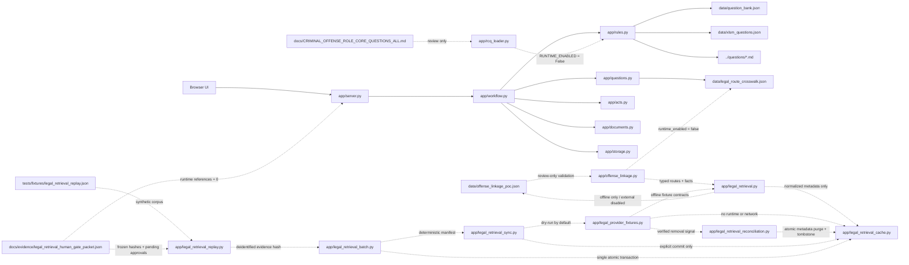

# 系統架構與資料邊界

## 1. 架構定位

`legal-case-web` 支援本機 loopback 與 Render Free 邀請制單人部署。核心目標是整理事實、保留多個候選法律路由、產生角色化問句及輸出筆錄；它不是自動定罪系統。

## 2. 元件責任

| 元件 | 責任 | 不負責 |
|---|---|---|
| `app/server.py` | 本機/Render HTTP API、安全守衛、案件與文件端點、登入 session | 法律判斷 |
| `app/workflow.py` | Gate 狀態、核准失效、角色分支、案件快照 | 自行補足事實 |
| `app/rules.py` | Gate 1 分析、規則候選、題目來源整合、題數限制 | 最終罪章認定 |
| `app/questions.py` | 問句 metadata、預算、去重、答案 overlay、候選重評估 | 從自由文字直接定罪 |
| `app/acts.py` | 行為層與競合待查提示 | 自動認定一行為／數行為或競合結論 |
| `app/law_reference.py` | 法源快照、多條號 spec 解析與行為時法警示 | 取代人工法律核對 |
| `app/moj_law_history.py` | 解析官方法規沿革頁並產生可重現快照（中文數字、條號範圍、施行日） | 產生條文、判斷從舊從輕 |
| `app/law_version.py` | 以沿革快照判定事件日是否需調閱行為時版本；`set_offenses` 逐條寫入判定並由前端警示顯示 | 重建歷史條文或作成法律結論 |
| `app/offense_linkage.py` | 驗證離線來源、罪章關聯與逐要件覆蓋 PoC | 接入 Gate 2、計算有罪機率或自動認定罪章 |
| `app/legal_retrieval.py` | 產生結構性去識別查詢、驗證防竄改內容、提供離線 adapter 契約 | 接收案件全文、呼叫外部 MCP／PSUE 或變更候選狀態 |
| `app/legal_retrieval_cache.py` | 正規化來源 metadata、區分 hash scope、驗證兩層完整性並以明示路徑原子寫入 | 保存全文／節錄／案件個資，或建立預設正式快取 |
| `app/legal_provider_fixtures.py` | 離線解析已有證據的 provider fixture，且把無公開契約來源鎖為 discovery-only | 發出網路請求、猜測 provider schema、清除正式快取或接入 Gate 2 |
| `app/legal_retrieval_reconciliation.py` | 以 registry 精確映射來源 locator，要求明示 cache 路徑並產生去識別 tombstone | 模糊匹配、保存原始 locator、恢復官方已移除來源或接入 runtime |
| `app/legal_retrieval_sync.py` | 離線協調 adapter、metadata 正規化、cache 寫入與移除流程；預設 dry-run | 使用外部網路 adapter、接受 provider 身分不一致、建立預設 cache 或接入 Gate 2 |
| `app/legal_retrieval_batch.py` | 驗證 deterministic manifest，於記憶體依序套用多 provider 項目並一次提交 | 部分提交、忽略 cache 漂移、保存案件內容、排程執行或接入 runtime |
| `app/legal_retrieval_replay.py` | 驗證合成 golden corpus、重播 allowlist provider 並產生固定結果投影與證據 hash | 接受案件資料、輸出 fixture／錯誤內文、覆寫既有 scratch cache 或宣稱法律驗收 |
| `app/legal_provider_tlr_pack.py` | 驗證 `twlegalrag pack` bundle 契約並對應已登錄 JID，僅輸出 citation metadata 與摘錄 hash | 保存判決全文、未經核准發出 live 查詢 |
| `app/provider_endpoint_policy.py` | 檢查 provider 端點僅為 loopback 自架、hosted 不可選，並回報 runtime 是否就緒 | 啟用 hosted 端點、代為核准 Human Gate |
| `app/documents.py` | 筆錄、條陳與頁數驗證 | 決定罪章成立 |
| `app/storage.py` | Runtime 使用程序記憶體的 `EphemeralCaseStore`；`CaseStore` 為未接線的持久化相容模組 | 案件歷史持久化或外部同步 |
| `app/rcq_loader.py` | 解析 RCQ 審查稿、品質檢核、產生人工工作表 | 未核准前接入 runtime |

## 3. Runtime 資料來源

問句來源的固定優先序如下：

1. `app/company_templates.py`：公司三份通用範本的逐字必問題。
2. `data/question_bank.json` 的 common 題。
3. `data/xlsm_questions.json`：公司 XLSM 罪章題。
4. 父目錄 `questions/*.md`：現有核心、補充、補強、區分及加重題。
5. JSON 要件題：同一 element 尚未由 Markdown 涵蓋時才補入。
6. `app/questions.py` 的受控情境問句，例如財物取走的七題中性事實題。

公司逐字題及必要核心題不得為符合題數或頁數限制而靜默刪除。超過預算時必須 fail closed，要求人工縮小候選路由。

`docs/CRIMINAL_OFFENSE_ROLE_CORE_QUESTIONS_ALL.md` 目前只是審查資料。它雖可由 loader 解析，仍因 `RUNTIME_ENABLED = False` 而不得注入正式題庫。

## 4. 法律路由資料

- `data/question_bank.json`：runtime offense、關鍵詞、element 與題目資料。
- `data/legal_route_crosswalk.json`：runtime route 與 child legal route 的明示對照。
- `data/law_reference_cache.json`：法源查詢的離線快照。
- `data/offense_linkage_poc.json`：普通竊盜、加重竊盜與普通侵占的來源化關聯 PoC；固定為 review-only，不是 runtime 題庫。
- `app/acts.py`：行為與候選之間維持 `HUMAN-ACT-LINKING-REQUIRED`，避免自動把所有行為套到單一罪章。

`VERIFIED_CURRENT` 只表示指定來源在指定版本可回查，不表示整個罪章、行為時法、競合或問句已完成法律審查。

## 5. 信任與資料邊界

- Render Free 部署使用邀請制單一帳號；案件只在服務程序記憶體處理，帳號資料存在暫存 SQLite，休眠、重新部署或重啟後都會遺失。Render 是案件資料處理邊界的一部分。
- 外部 AI 僅能在使用者啟用且有金鑰時接收有長度限制的案情摘要，用於提出候選方向。
- 外部 AI 結果與規則結果都只是候選，不是法律結論。
- 公開書類只可在去識別、來源識別穩定、使用邊界與 Human Gate 都完成後匯入；目前起訴書維持 `NOT_INGESTED`。
- 法律檢索查詢只接受固定 route、fact target 與有限狀態；姓名、地址、案號及案情自由文字沒有輸入通道。外部 adapter 在 Human Gate 前 fail closed。
- 法律檢索快取只保存公開來源 metadata。`REGISTERED_SOURCE_FINGERPRINT_NOT_FULL_DOCUMENT` 不得升級解讀為官方全文 hash；全文與案件欄位出現時必須拒絕寫入。
- provider fixture 層只驗證 `mcp-taiwan-legal-db`、TLR anchor 與司法院 `JDoc` 的已公開契約；Taiwan Law MCP 與 PSUE 在 response/API schema 未驗證前維持 discovery-only。
- 司法院 `JDoc` 全文只供記憶體內 hash 計算。來源移除 reconciliation 只操作呼叫者明示的離線 metadata cache；移除、tombstone 與稽核事件以同一原子替換提交，不保留可恢復的已移除來源副本。
- cache v2 可讀取 v1 並在下次寫入時升級。tombstone 只保存 locator SHA-256，且會阻止相同 `source_id` 被舊結果重新寫入；解除 tombstone 尚無自動路徑。
- offline sync report 不包含 query text、fixture summary、官方錯誤文字或原始 locator。`commit=True` 只表示對呼叫者明示的 cache 執行寫入，不代表 runtime、外部 provider 或法律流程已獲核准。
- batch transaction 開始時封存 cache payload hash，commit 前再次讀取比對；有並發漂移時 fail closed。dry-run 丟棄記憶體副本，不建立 temp file；正式 commit 只有一次 `os.replace`，且底層替換失敗時保留原檔。
- golden replay corpus 固定標記 `contains_case_data: false`，禁止姓名、地址、案件 payload、全文、摘要與節錄欄位。Replay 的 `PASS` 只表示目前程式輸出符合合成預期，不是官方 provider、法律內容、Human Gate 或 runtime 驗收。
- Human Gate packet 凍結核心 PoC 與 runtime surface hash；任何 hash 漂移都使封包失效。五項 approval 未全部由對應人工角色核准前，`decision_status` 必須維持 `PENDING_HUMAN_APPROVAL`。
- API 金鑰不得進入瀏覽器、題庫、文件、log 或版本控制。
- Render Free 使用公網入口及登入保護；本機檔案系統為暫存，不作帳號持久保存，失效後需以保留的邀請碼重新註冊。這不是網路層私有服務或 IP 白名單；部署設定不授權公開辦案或外部同步。

## 6. 變更界線

修改架構前，必須先確認：

- runtime entrypoint 是否真的可達。
- 固定公司題、XLSM、Markdown 與 JSON 的載入順序是否保持。
- Gate 核准與 revision conflict 是否仍 fail closed。
- 新資料欄位是否向後相容。
- RCQ review-only 資料是否仍隔離。
- 測試綠燈是否只被描述為工程證據，而非法律驗收。

## 7. 文件控制面與 Runtime 邊界

| 文件 | 控制責任 | 是否直接驅動 runtime |
|---|---|---:|
| `QUESTION_DESIGN_AND_USE.md` | 案情、候選、問句、回答與 Human Gate 規約 | 否 |
| `LAW_REGISTRY.md` | 法規身分、別名、版本線索與 route 關聯索引 | 否 |
| `LAW_LIFECYCLE.md` | 新增／更新法規的查證、分類與影響分析 | 否 |
| `OFFENSE_QUESTION_WORK_QUEUE.md` | 現有 routes 的工作範圍與狀態 | 否 |
| `AI_EXECUTION_PROTOCOL.md` | 其他 AI 的任務分類與有限 loop | 否 |

自然語言的「新增某法相關罪章」與「更新某法」目前只啟動受控的文件／程式維護流程。應用程式沒有通用命令解析器，也不會自動爬取、判斷或寫入現行法。若未來要做成 runtime 功能，必須另行設計官方來源連接、版本資料模型、審批、稽核與失敗關閉機制。
